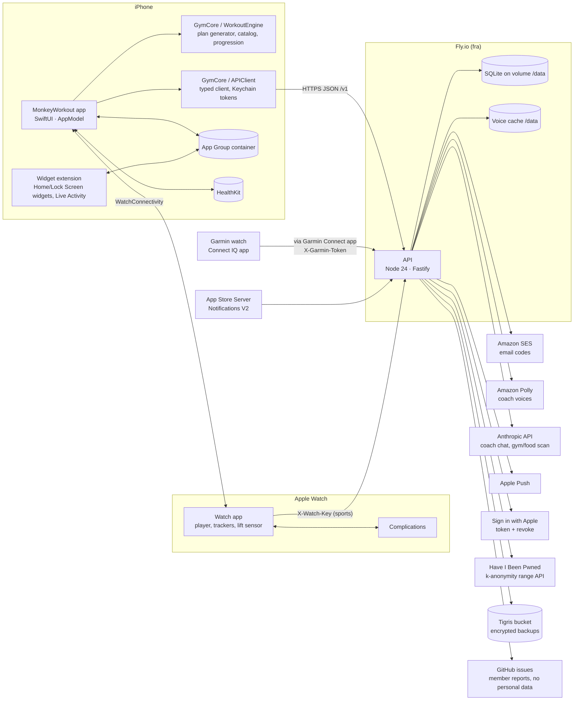
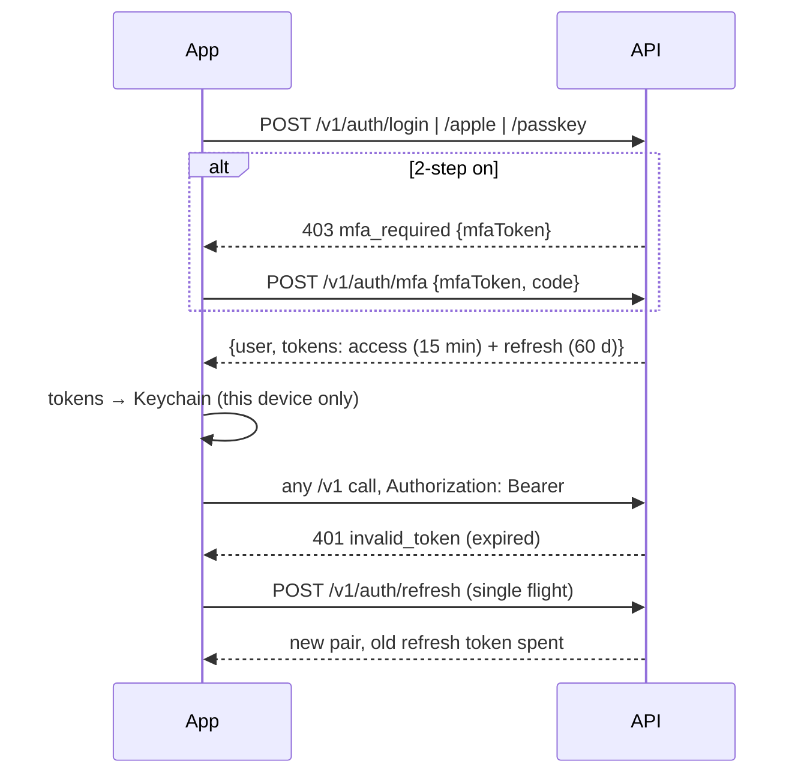
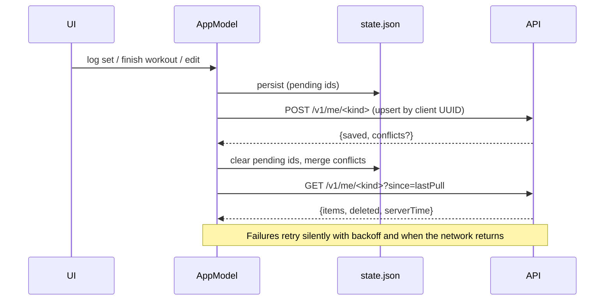

# Architecture

## Components

| Part | Path | Stack |
|---|---|---|
| iPhone app | `ios/MonkeyWorkout` | SwiftUI, iOS 18+, `@Observable` `AppModel` split into `AppModel+<Feature>.swift` |
| Engine | `ios/Packages/GymCore/Sources/WorkoutEngine` | Pure Swift, deterministic per seed, exercise catalog, techniques, food, recipes |
| API client | `ios/Packages/GymCore/Sources/APIClient` | `URLSession` without HTTP cache, Keychain token store, single-flight refresh |
| Widgets + Live Activity | `ios/MonkeyWorkoutWidgets`, `ios/HomeWidgets`, `ios/Shared` | WidgetKit, ActivityKit, App Intents |
| Watch app | `ios/MonkeyWorkoutWatch`, `ios/WatchShared` | SwiftUI, HealthKit workout sessions, Core Motion |
| Watch complications | `ios/MonkeyWorkoutWatchComplications` | WidgetKit on watchOS |
| Garmin app | `garmin/` | Monkey C (Connect IQ) |
| API | `backend/src` | Node 24 (TS type stripping), Fastify 5, `node:sqlite`, zod, jose, SimpleWebAuthn |

## Design principles

- **Offline first.** The plan, the player, logging and Fuel run on the device. Every change is written to the local store first, then queued for sync. The gym may have no signal.
- **Engine on the device.** The server never generates training; it stores the profile and the member's records (see [engine/training-methodology.md](engine/training-methodology.md)).
- **Server = accounts, sync, sharing, paid services.** Anything costing money per call (Claude, Polly) goes through the server with caps.
- **Single SQLite file per environment.** Small scale, one machine, volume snapshots + daily verified backup + encrypted off-site copy.
- **Same image staging → prod.** Prod runs the exact image validated on staging ([ci-cd.md](ci-cd.md)).

## Key flows

### Sign-in

### Sync (outbox)

### Workout on the Watch

The iPhone sends the session to the Watch over WatchConnectivity; the Watch runs a HealthKit workout session, mirrors heart rate and set events back, and the phone records the workout. Sport sessions recorded on the Watch alone upload directly with an `X-Watch-Key`. Details: [ios/devices.md](ios/devices.md).

### Garmin

The Garmin watch pairs with a 6-letter code, reads a snapshot the phone publishes, and posts events the phone collects from an inbox. The watch never talks to the phone directly. See [ios/devices.md](ios/devices.md#garmin).

### Release

`DEV → branch → PR (CI) → squash-merge to main → staging auto-deploy → validate → Promote to production (manual, same image) → TestFlight (manual)`. See [ci-cd.md](ci-cd.md).
