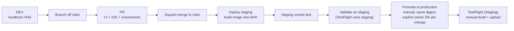

# CI/CD and release

## Release flow (trunk-based)

1. Develop and test on DEV ([development.md](development.md)).
2. Branch off `main`, open a PR. Every change has a GitHub issue and a `CHANGELOG.md` entry ([contributing.md](contributing.md)).
3. CI must be green, then **squash-merge**. `main` is staging: the merge builds `ghcr.io/jeanyves-figiel/gym-workout-api:sha-<sha>` (+ `:staging`) and deploys it to `monkeyworkout-staging`; **Staging smoke test** follows.
4. Validate on staging.
5. **Promote to production** (Actions, manual): re-tags the same digest as `:prod` and deploys it to `monkeyworkout-prod`. No rebuild. Input `sha` (blank = what staging runs). Never run without the owner's explicit OK for that change.
6. **TestFlight (Staging)** (manual) archives the app on a macOS runner and uploads it; build number = run number. Internal group gets it automatically; **TestFlight distribute** adds other groups.

Several streams of work are bundled into one release: all merge to staging, an integration check runs, then one promote and one TestFlight build.

## What's new (every release)

`ios/MonkeyWorkout/Resources/WhatsNew.json` is shown once after an update: an `id` (release date + counter) and one card per new thing (`symbol`, `tint` category, `title`, `body`), no card limit. When starting a new release's notes, the last shipped notes (with `build` and `date`) move to the top of `WhatsNewHistory.json` (Settings › What's new). `.github/scripts/check_whats_new.sh` validates both on every PR; **TestFlight** fails if the `id` is unchanged since the last `testflight-<build>` tag, unless `same_whats_new` is ticked (plain rebuild). Feature PRs suggest a card line in the PR body; the release owner writes the entry.

## Workflows

| Workflow | File | Trigger | Does |
|---|---|---|---|
| CI | `ci.yml` | PR, called by Deploy staging | What's new check; backend `npm ci`, typecheck, tests (incl. docs drift); backend image build |
| iOS | `ios.yml` | PR / push to `main` touching `ios/**` | GymCore package tests, simulator builds (Debug, Staging), device build with an app size report in the job summary (#932), UI tests (build-for-testing, booted simulator, a failed test retried once) |
| App Store screenshots | `app-store-screenshots.yml` | PR, manual | Demo-mode screens captured (≤ 800 px) to branch `screenshots/pr-<n>` and an artifact |
| Deploy staging | `deploy-staging.yml` | push to `main` | CI, image to GHCR, deploy to staging |
| Staging smoke test | `staging-smoke.yml` | after Deploy staging, manual | Health + real mail transport, sign-up email, unverified login refused, forgot password, auth guards |
| Promote to production | `promote.yml` | manual | Same image digest to production |
| TestFlight (Staging) | `testflight.yml` | manual | Archive, sign (App Store Connect API key, cloud signing), upload; `prune_ci_certs`, `same_whats_new` |
| TestFlight distribute | `testflight-distribute.yml` | manual, called | Add a build to a TestFlight group |
| TestFlight crashes | `testflight-crashes.yml` | manual | Download crash reports from App Store Connect |
| Symbolicate crash | `symbolicate.yml` | manual | Symbolicate a crash log |
| App Store listing | `asc-listing.yml` | manual (dry run first) | Push `ios/AppStore/listing.json` (text, categories, age rating, App Review info) to App Store Connect |
| App Store subscriptions | `asc-subscriptions.yml` | manual (dry run first) | Create / update Pro products in App Store Connect |
| Garmin watch app | `garmin.yml` | PR, push, manual | Build the Connect IQ app (once Garmin secrets exist) |
| Garmin signing key | `garmin-key.yml` | manual | Generate the Connect IQ developer key straight into a secret (never in a log or artifact) |
| Coach live check | `coach-live.yml` | manual | One real Ask Coach call (Claude) or one real Polly voice recording; prints the answer or error |
| HD animations pack | `hd-animations.yml` | push to `main` touching `ios/HDAnimations/**` or `ios/HDMotion/**` (#944 clips), manual (dry run default) | Packs the HD exercise animations (`pack.py`) and publishes new files + `manifest.json` to the `hd-animations` release; deletes files the manifest no longer lists (#932) |

### Operations workflows

All manual, target `staging` or `production`, run commands on the Fly machine over `flyctl ssh`:

| Workflow | Actions |
|---|---|
| Fly setup | Create app, volume, certificate; set secrets (random `JWT_SECRET` / `CODE_PEPPER`, forwarded keys). Idempotent; re-run after any secret change |
| Fly backups | Daily 04:30 UTC snapshot check; status, backup-now, snapshot-now, verify, retention, restore (confirm = app name), member-restore, member-delete (confirm = email), off-site setup / rotate / fetch |
| Fly logs | Recent logs |
| Fly undo workout | Remove a wrongly recorded workout for a member (dry run first, then apply) |
| Free access | Grant / revoke / list free Pro access per account, or grant-all with an end date |
| Staging testers | Add / remove / list accounts allowed to use Pro test mode (fake purchases) on staging (#924) |
| Week challenge review | List member challenge suggestions waiting for review, approve (into the member-week vote) or reject one (#748) |
| CodeQL export | Same CodeQL suite as default setup, no upload: prints every result for one language (Swift default) to the log and summary (#964) |
| AI usage | Paid AI calls per day and feature: calls, failures, tokens, cache hit, estimated US$ cost, `AI_DAILY_LIMIT` use (#877) |

## Signing and App Store

- Xcode project generated by XcodeGen from `ios/project.yml`; bundle ids and API URL per configuration in `ios/Config/*.xcconfig` ([ios/README.md](../ios/README.md)).
- CI signs with an App Store Connect API key (`ASC_KEY_ID`, `ASC_ISSUER_ID`, `ASC_KEY_P8`); no certificates or profiles in the repo. Apple's certificate limit: `prune_ci_certs` revokes old CI-made development certificates.
- App IDs, App Group and capabilities (HealthKit, Sign in with Apple, Associated Domains, push) are created by the owner in the developer portal (the CI key can't). App IDs: the app, `.LiveActivity`, `.ShareExtension` (#909, App Group), `.watchkitapp`, `.watchkitapp.Complications`.
- App Review notes: [app-store-review.md](app-store-review.md).

## Mac runners

macOS jobs can queue for a long time. When a PR touches only docs or backend, the iOS workflow does not run (path filter). Cancel superseded iOS runs to free runners.
