# Server data model

One SQLite database per environment (`DB_PATH`, `/data/app.db` on Fly), opened with `node:sqlite`, WAL journal, foreign keys on.
Full schema (generated after every migration): [reference/schema.sql](reference/schema.sql). On-device stores: [ios/on-device-data.md](ios/on-device-data.md).

## Conventions

- Ids are TEXT (UUIDs; client-generated for synced records so retries upsert). Synced ids are stored lower case (#714; older upper-case rows renamed once, the newer of two spellings kept).
- Times are ISO-8601 UTC TEXT (`…T10:00:00.000Z`), compared as strings.
- Member-owned rows have `user_id … REFERENCES users(id) ON DELETE CASCADE`: deleting the account removes everything.
- Many records are **opaque JSON** in a `data` column (the app owns the shape; the server only validates size and ids). This keeps the server stable while the app evolves.
- Migrations run at startup, idempotently (`CREATE TABLE IF NOT EXISTS`, column checks, `schema_version`). One-time data fixes are recorded by name in `schema_fixes`. Code: `backend/src/db.ts`, `schemaExtras.ts`, `security.ts`, `gymSchema.ts`, `community/schema.ts`, `push/schema.ts`, `subscriptions/schema.ts`, `throttle.ts`.

## Entities

```mermaid
erDiagram
  users ||--o{ refresh_tokens : "sessions"
  users ||--o| profiles : "app profile JSON"
  users ||--o{ workout_logs : "set logs"
  users ||--o{ workouts : "finished sessions"
  users ||--o{ custom_workouts : "has"
  users ||--o{ custom_exercises : "has"
  users ||--o{ pr_attempts : "has"
  users ||--o{ body_measurements : "has"
  users ||--o{ climbs : "has"
  users ||--o{ sports : "has"
  users ||--o{ machine_notes : "has"
  machine_notes ||--o| machine_note_photos : "has"
  users ||--o| community_profiles : "joined Community"
  users ||--o{ community_posts : "has"
  community_posts ||--o{ community_reactions : "cheers"
  users ||--o{ community_programs : "shares"
  community_programs ||--o{ community_program_copies : "copied"
  users ||--o{ community_follows : "has"
  users ||--o{ community_blocks : "has"
  users ||--o{ passkeys : "has"
  users ||--o| totp_secrets : "has"
  users ||--o{ push_devices : "has"
  users ||--o{ app_store_subscriptions : "has"
  users ||--o{ garmin_devices : "has"
```

| Area | Tables | Notes |
|---|---|---|
| Accounts | `users`, `user_profiles`, `codes`, `email_changes`, `refresh_tokens`, `apple_tokens` | Password Argon2id hash (older scrypt until next sign-in); email codes and refresh tokens stored as hashes; Apple refresh token AES-256-GCM encrypted; failed-login counters and lock; `users.tokens_valid_after` ends access tokens issued before it |
| Security | `reauth_grants`, `reauth_codes`, `mfa_challenges`, `totp_secrets`, `recovery_codes`, `passkeys`, `webauthn_challenges` | TOTP secret encrypted; grants, codes and recovery codes hashed; short-lived challenges purged |
| Training sync | `profiles`, `workout_logs`, `workouts`, `custom_workouts`, `custom_exercises`, `pr_attempts`, `body_measurements`, `climbs`, `sports`, `machine_notes`, `machine_note_photos`, `sync_tombstones`, `watch_keys` | Upsert by client id; tombstones 180 days; machine photos owner-only; `(user_id, julianday(<time>))` indexes order the export by instant |
| Community | `community_profiles`, `community_avatars`, `community_posts`, `community_reactions`, `community_follows`, `community_blocks`, `community_reports`, `library_saves`; live group sessions (#626): `community_buddies`, `community_live`, `community_live_cheers`, `community_challenge_scores` (#748: `tier`, `seconds`); week challenge (#748): `community_challenge_suggestions`, `community_challenge_votes`, `community_challenge_weeks` (member-week winner pinned with a WOD snapshot); shared plans (#666): `community_programs`, `community_program_copies` | Visibility `private`/`members`/`public`; auto-hide after 3 distinct reports; live rows stale after 10′, cheers kept 10′; `community_profiles.gym_id/gym_name/gym_key/gym_lat/gym_lon` copy the training-profile gym (indexed, for member search); copy and save counts are counted from `community_program_copies` and `library_saves`; `community_profiles.socials` (JSON handles) + `socials_visibility` everyone/following/nobody (#745) |
| Invites (#745) | `referral_codes`, `referrals` | One code per account (made on first use); `referrals.invitee_id` is unique (a code is entered once, accounts ≤ 14 days old); subscribed counts are read live from `app_store_subscriptions` (paid, not trial, not revoked) |
| Gyms | `gym_reports`, `gym_maps`, `gym_busy` | Only aggregates leave the server, never who reported; one row per member and place; indexed `name_key` (normalized words) for look-up by name |
| Push | `push_devices`, `notification_prefs`, `achievement_announcements` | APNs device tokens; each achievement pushed once, at most 20 a day per member |
| Subscriptions | `app_store_subscriptions`, `app_store_notifications`, `access_grants`, `subscription_tests` | One App Store original transaction belongs to one account |
| Garmin | `garmin_devices`, `garmin_snapshots`, `garmin_inbox` | Token hashed; inbox capped |
| Paid usage | `coach_chat_usage`, `gym_scan_usage`, `food_scan_usage`, `ai_daily_usage` | Daily counters per member and global |
| Support | `member_reports`, `member_report_shots` | Problem reports with screenshots (EXIF stripped), in the export |
| Ops | `throttle_hits`, `schema_version`, `schema_fixes` | Sliding-window throttles (export, codes, mails, pushes); one-time data fixes done |

## Lifecycle

- **Purge job** (startup + every `PURGE_INTERVAL_MIN`, default 60): expired codes, email changes, challenges, grants; refresh tokens past expiry; revoked tokens 24 h after their family ends; sync tombstones after 180 days; App Store notifications after 90 days; old "Taken?" taps. Code: `backend/src/purge.ts`.
- **Account deletion** (`DELETE /v1/me`): cascades every row, removes `throttle_hits` keyed by the member's id or email and the call-name recordings held in memory, revokes Sign in with Apple at Apple. Backups age out within the retention windows in [security.md](security.md#backups).
- **Export** (`GET /v1/me/export`): every table above that holds the member's data, as JSON, photos inline, streamed row by row (synced records in time order). Secrets are left out: passkeys as id, name and dates; 2-step and watch key as on/off.

## Ops tools (`backend/src/admin/`)

Run on the Fly machine through manual GitHub workflows, never over HTTP: `backup.ts` (backup / verify / restore / off-site), `deleteMember.ts`, `restoreMember.ts`, `undoWorkout.ts`, and `admin.ts` (free Pro access grants, week challenge review). See [ci-cd.md](ci-cd.md#operations-workflows).
