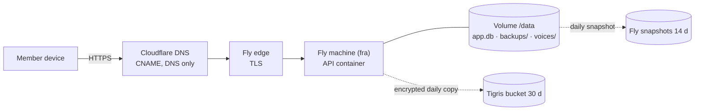

# Infrastructure

Nothing runs on a laptop: hosting is Fly.io, setup and operations are GitHub Actions workflows. Server env reference and first-time setup: [`backend/README.md`](../backend/README.md#hosting-flyio).

## Environments

| | staging | production |
|---|---|---|
| Fly app | `monkeyworkout-staging` | `monkeyworkout-prod` |
| Config | `backend/fly.staging.toml` | `backend/fly.production.toml` |
| URL | `https://workout-staging.monkeygrade.cloud` | `https://workout.monkeygrade.cloud` |
| Deployed by | **Deploy staging** on every push to `main` | **Promote to production**, manual, same image digest |
| Used by | TestFlight builds, App Store sandbox notifications | App Store builds |
| Pro test mode | `SUBSCRIPTION_TESTS=on` | off |

Each: region `fra`, one `shared-cpu-1x` machine (256 MB), 1 GB volume at `/data` (SQLite, backups, voice cache), `/healthz` check every 30 s, machines stop when idle and start on request. Image: `ghcr.io/jeanyves-figiel/gym-workout-api:sha-<sha>` (Node 24, runs as `node`; the entrypoint only fixes `/data` ownership as root).

## DNS

Domain `monkeygrade.cloud` in Cloudflare (shared with the owner's other apps: add only, never change other records). `workout` and `workout-staging` are DNS-only CNAMEs to the Fly apps; Fly issues the TLS certificates.

## Third-party services

| Service | Use | Notes |
|---|---|---|
| Fly.io | Hosting, volumes, snapshots, Tigris object storage | Paid account; `FLY_API_TOKEN` in GitHub |
| Amazon SES (eu-central-2, Zurich) | Email codes and notices from `no-reply@monkeygrade.cloud` | HTTPS API with SigV4 (Zurich has no SMTP endpoint); dedicated IAM user; `SMTP_URL` alternative; without either, codes go to logs (DEV) |
| Amazon Polly (neural) | Studio coach voices | Each line synthesized once per voice, cached on the volume |
| Anthropic API | Coach chat, gym scan, food scan | Daily caps per member and global |
| Apple | Sign in with Apple (token, revoke), APNs push, App Store Server Notifications V2, StoreKit 2 | Keys as Fly secrets |
| Have I Been Pwned | Breached-password check | k-anonymity, fails open |
| Open Food Facts | Barcode lookups from the app | Called from the device |
| GitHub | Code, CI/CD, container registry, issues (member problem reports, without personal data) | |
| Garmin Connect IQ | Garmin watch app distribution | Developer key made by a workflow |
| Cloudflare | DNS | |

## Configuration

Non-secret settings are `[env]` in `fly.*.toml` (e.g. `NODE_ENV`, `DB_PATH`, `MAIL_FROM`, `APPLE_TEAM_ID`, `WEBAUTHN_RP_ID`, `LEGAL_*`, `SUBSCRIPTIONS`). Secrets are Fly secrets set by **Fly setup** from GitHub secrets (names in [security.md](security.md#secrets)). Every env variable the server reads is in `backend/src/config.ts`; optional ones are listed in `backend/README.md`.

## Monitoring and operations

- `/healthz` checked by Fly; **Staging smoke test** runs after each staging deploy (and on demand against production).
- **Fly logs** workflow pulls recent logs (machine auto-stop limits history to the last start).
- **Fly backups** runs daily at 04:30 UTC (snapshot check) and on demand: status, backup-now, snapshot-now, verify, retention, restore, member-restore, member-delete, off-site setup / rotate / fetch.
- Crash reports: **TestFlight crashes** and **Symbolicate crash** workflows.
