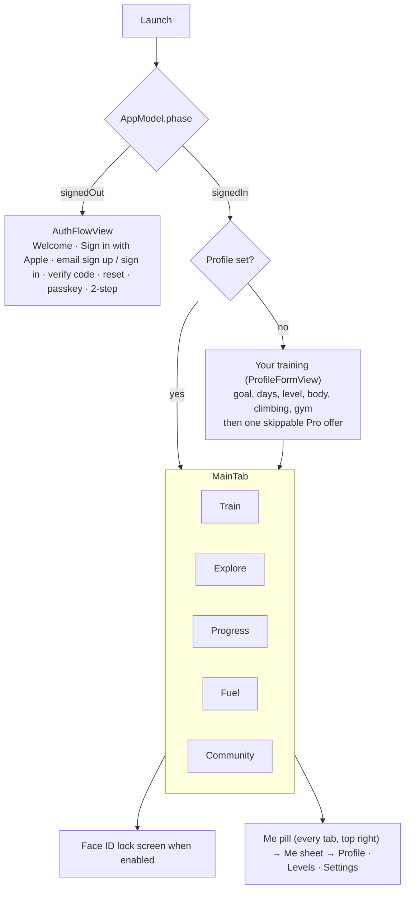

# iPhone app

SwiftUI, iOS 18+. Setup and build: [`ios/README.md`](../../ios/README.md). Watch, widgets and other devices: [devices.md](devices.md). Local files: [on-device-data.md](on-device-data.md).

## Code map

| Path | Content |
|---|---|
| `App/` | `MonkeyWorkoutApp` (entry, URL handling), `AppConfig` (API URL from Info.plist), `AppLock` (Face ID), `WhatsNew`, `HomeWidgetSync` (widget data + `monkeyworkout://` router), `Demo` (DEBUG demo data), `AppleCredentialCheck` |
| `Model/` | `AppModel` (auth phase, plan, logs, sync) split by feature into `AppModel+<Feature>.swift`; `LocalStore` (`state.json`), `FuelStore`, `MoveStore`, `LiftSets`, `ProStore` (StoreKit 2), `Community`, `WatchWorkouts` |
| `Views/` | One folder per area (below); shared pieces in `Views/Components` (`TabHeader`, `LensDayStrip`, `AutoSave`, `UndoClose`, `BodyMapView`, `BodyMap3DView`, `ExerciseImage`, `WhatsNewView`, `Theme`) |
| `Health/` | `HealthManager`: HealthKit reads (HRV, resting HR, sleep, steps, flights, workouts from other apps) and workout writes |
| `Notifications/` | Local reminders and check-ins, APNs registration, notification routing |
| `Watch/` | `WatchSync` (WatchConnectivity), `GarminSync` |
| `Packages/GymCore` | `WorkoutEngine` (plan generator, catalog, progression, Fuel, recipes, techniques) and `APIClient` |

## App structure

The app turns signed-in from the Keychain token before any network call, so every tab renders from the local cache on the first frame. Every tab header is a `TabHeader` with tab actions as 44 pt square tiles and the **Me pill** (level + photo) at the right.

## Tabs

### Train (`Views/Plan`, `WeekView`)

Customisable widget board (Edit Train, `TrainEditViews`, `TrainWidgets`): by default a week strip (`LensDayStrip`, opens on today), Coach Monkey card with week tiles (This week, phase, Ready), today's day card, Next up, then the week list.

- **Day card:** title with jump chip, action tiles (Add workout, Plan sport, Log climb, Freestyle, Log sport, Track live). Only today's session starts; later days show *Planned for <day>*; missed days offer *Log it* (`MissedViews`).
- **Past day card** (`PastDayCard`, #592): every earlier day (done, rest, climbing, missed, last week) uses one card. Everything logged that day is a gradient row (`DayLogRow`): gym opens what was done, climbs and sports logged here open to edit (Log climb / Log sport in edit mode: saved over itself, Health workout replaced, Delete), Health sessions their page; long press = Edit + Delete. A missed session is a white *Log it* row. Tiles: **Workout** (a plan workout logged on that day as an extra, `MissedLogSheet(day:)`) and **Sport**, or **Log climb** on a climbing day with no climb yet. Demo screen `train-past-day`.
- **Session page** (`SessionView`, `SessionFlowViews`): warm-up, blocks, cool-down; edit before start (`EditExercisesSheet`), swap (`SwapExerciseSheet`, `ChangeExerciseSheet`), workout style and focus, superset fixes, time fit (`WorkoutTimeViews`). Session flow Edit (`SessionFlowSheet`) for plan sessions and generated quick extras (extras: this workout only, exercises picked again).
- **Player** (`WorkoutPlayerView`, `PlayerHero`, `PlayerQuickLog`, `PlayerLandscape`): one exercise at a time, fixed positions, no scrolling, kg × reps × effort entered once per set, rest timer, one Up next bar, Live Activity, pause / resume across app kills, finish early (`FinishEarlySheet`), close with Undo toast. Coach lines and studio voices (`WorkoutCoach`, `CoachVoices`), Watch lift sensor (`LiftSensorViews`), expert lifts.
- **Timers** (#622, `WodTimerViews`, Workout library): kind tiles (Tabata, EMOM, AMRAP, For time, Rounds, Boxing) open the builder (`WodBuilderSheet`: numbers, moves, punches on Watch); saved timers (`WodStore`, `wod-timers.json`) auto-save, long press = Edit / Delete with Undo. **Big screen** (`BigScreenTimerView`): full screen, turns sideways, keeps the screen on, huge countdown, round, moves, sound + haptic cues; the Watch's double tap starts and pauses it.
- **Swim** (#624, `SwimPlanViews`, Workout library): plans Learn to swim / 1 km non-stop / 2 km (8 weeks, 2–3 swims a week on days without lifting, last swim = non-stop test, `SwimPlan`), next swim and the week's swims (`SwimWorkoutSheet`: sets with send-offs), **Start on Watch** on a swim day, **Pool + gym**: a swim warm-up or finisher on a gym day (`SwimBlockCard`, also on the session page; tap cycles 10/15/20/30′, chip switches warm-up / finisher, long press removes with Undo), pool length, open water buddy alert minutes (`SwimStore`, `swim.json`).
- **Freestyle / build as you go** (`FreestyleViews`): pick → do → pick with Coach picks and a trail.
- **Plan tools:** Calendar with away periods and trips (`CalendarViews`), programmes and builder (`ProgrammeViews`, `ProgrammeBuilderViews`, Hyrox, snow), split, training methods and style, plan changes, variation, growth goals, fresh start after time away, readiness card.
- **Recover** (`RecoveryViews`, `AppModel+Recovery`, engine `Recovery`, #619): today's and coming rest days show a ~12′ mat routine for the area trained hardest in the last 7 days (Hips & back, Legs, Shoulders & chest or Full body) with the days that loaded it; Start opens its session page. On a "Take it easier" readiness day with a strength session, a **Readiness swap** card in the notice slot offers **Swap** (session moves to the next free day this week, today becomes a recover day) or **Keep** (hidden until tomorrow). Example, own and shared workouts without a cool-down get a 5′ **Cool-down** finisher (4 stretches for what they loaded most).
- **Sport season blocks** (#620, engine `Programme+Season`, `SportAddOn`; app `SportAddOnViews`, `AppModel+SportAddOn`): Explore → Programmes opens with **Get ready for…** (Ski, Padel, Climb, Run, Surf, Football tiles → Snow ready, Climber's power or a `season-*` programme whose page asks when the season starts and fits 5–12 weeks to it). **Sport add-on**: a 15′ sport block added to the week's first 1–3 strength sessions (appended to their mobility block or as one), set under the tiles (sessions a week, remove) or from the Coach's card in the notice slot when a sport was logged 3+ times in 14 days (**Add 2× week** / **No**, hidden 30 days). Stored in `SyncedProfile.sportAddOn`.
- **Skill tree** (#621, engine `Skills`, `SkillProgress` in `SyncedProfile.skills`; app `SkillViews`, `AppModel+Skills`): Explore → Programmes → **Skill tree**: Pull, Push, Legs, Balance & core branches of square nodes (passed lime, current white, locked dim). A node opens its **test** (max reps with − / +, or a hold timer); reaching the target unlocks the next level. **Skill of the month**: one node, a 10′ practice (`skill-practice-*` template) offered on Train on Monday, Wednesday and Friday with the month's days done / goal and a chest when the goal is met.
- **Run & cardio** (`RunViews`, `AppModel+Runs`, engine `RunPlanner`, #618): Training profile → **Run & cardio** sets a race (5K, 10K, half; date, goal time, name, 2–4 runs a week) or **Hybrid** (two Zone 2 sessions, bike/row/run, and one interval day). Runs are placed around this week's lifting (long run Saturday, never on or the day after a legs day; hard runs not after legs; gym-free days first) through Base, Build, Peak, Taper and race week, paced from the goal time. Train shows the **goal race card** (countdown, M–S strip with lift / run / rest, today's run) under Next up. A run opens **RunSessionSheet**: its steps, **Start** (design C: MonkeyFit player on the Watch or Apple Workout, *Remember for running* per sport, `RunStartChoice`) and **Send to Workout app** (#610, WorkoutKit: `AppleWorkoutPlan` builds a `CustomWorkout` with warm-up, interval blocks with iterations, cool-down, pace or heart-rate zone alerts; `workoutPreview` shows Apple's sheet). A run is done when Health has a run, ride or row of half its time that day (Apple's Workout app included).
- **Bike sensors** (Settings → Watches, `BikeSensorsView`, `AppModel+Bike`, #623): FTP (stepper, W/kg), the 7 power zones in watts, last test and retest due (6 weeks), how to pair sensors and run the FTP test on the Watch. Stored in `SyncedProfile.bikeFTP` / `bikeFTPTestedAt`.
- **Life stages** (#625, engine `LifeStage`, `LifeStageCheckIn` in `SyncedProfile.lifeStage`; app `LifeStageViews`, `AppModel+LifeStage`): Explore → Programmes → **Life stages** cards (Pregnancy, Postpartum, 50+, Back to training). The page starts with a **check-in** (due date → trimester, birth date, weeks off) and a **doctor's OK** toggle that unlocks Start; **Swapped for you** lists the safety guard's swaps with why; **Pace by feel**. While one runs, `lifeGuarded` swaps risky moves in the plan (uids kept, block note says what and why), sets every working set to the talk test, and the player hides PR attempts.
- **Live group sessions** (#626, `LiveRoom`, `LiveViews`, APIClient `Live.swift`): Community shows **Gym buddies** (invites to pair, paired buddies with their live set and 🔥 🍌 🦍 cheers) and the **Week challenge** card. A member page has **Gym buddy** (invite / accept / unpair); the invite and the pairing arrive as push `buddy_invite`, which opens that member's page. While the player runs, `LiveRoom.player` sends the current set (`PUT /v1/community/live`, on state change, otherwise at most every 5″, refreshed every 2′) only when a paired buddy exists or the challenge runs; every 15″ it polls cheers and buddies' sets and shows them as `BuddyToast` over the player and on the Watch (`WatchSync.sendBuddy`). **Week challenge** (`ChallengeRoomView`): `WeeklyChallenge.wod(for:)` (LiftSensor) gives the ISO week's AMRAP 12′, START runs it on `BigScreenTimerView` (sent live with `challengeWeek`), then the score sheet saves rounds + reps; the leaderboard refreshes every 20″ while open.
- **Sports and climbing:** plan sport days, sport prep (before/after), track live or log, sport maps (`SportViews`, `SportPrepViews`, `SportMapViews`); climbing logs and Wall session (`ClimbViews`, `WallSessionViews`).
- **Ask Coach** (`AskCoach`, `CoachChatViews`): chat bubble on most screens; can propose a workout or an action.
- **On-device Coach** (`OnDeviceCoach`, #608): on iOS 26+ iPhones with Apple Intelligence (`SystemLanguageModel`), short training questions (`CoachRoute.onDevice`: no workout asked for) are answered by the on-device model with an **⚡ On device** badge (`OnDeviceBadge`): offline, nothing sent, no daily limit. It also answers when the server Coach is off, out of messages or unreachable. The finish screen shows a **recap card** (`RecapCard`, engine `WorkoutRecap`: two lines + a tip from the record vs the last time each lift was done), reworded by the model (`RecapDraft`, `@Generable`) when available. Settings → Ask Coach → *Quick answers on device* (`askCoach.onDevice`).
- **Voice logging** (#617): the player mic and Ask Coach use `SpeechAnalyzer` + `SpeechTranscriber` on iOS 26 (language assets downloaded in the background the first time, `SFSpeechRecognizer` meanwhile and on iOS 18–25). `VoiceCommand.set` logs a set from one sentence: "eight at eighty", "8 reps at 82.5 kg", "100 kilos for 5"; number words fold into numbers ("sixty two point five").
- **Visual Intelligence** (#617, `VisualLookup.swift`): `MachineVisualQuery` (`IntentValueQuery` on `SemanticContentDescriptor`) turns the camera's labels into exercises for that machine (`MachineMatch`); `OpenExerciseIntent` opens the page (`ExerciseLaunch` → sheet on `RootView`).
- **Tips** (`HiddenGestureTips`, TipKit, #617): Hold 🐵 to talk, Log a set by voice (player mic), Fix a set (set chips, after the first set). Once each, daily at most; hidden in demo mode.

### Explore (`Views/Library`)

Two-level menu (`ExploreMenu`): **Exercises** by muscle (2D/3D body map, `MuscleHero`), by machine, by type; **Ready-made** workouts and plans (`WorkoutLibraryViews`, shared library from members).

- Exercise page (`ExerciseDetailView`, `ExerciseJumpBar`): animation, technique cues (`TechniqueView`), position guide, variations (`VariationSheet`), history and records (`ExerciseHistoryView`), PR attempt (`PRAttemptView`), machine setup notes with photo (`MachineNoteViews`).
- Custom exercises (`CustomExerciseBuilderView`, pose designer) and custom workouts (`CustomWorkoutViews`, share to library).
- Gyms (`Views/Gyms`): gym finder and place search, equipment setup (`GymSetupView`, `EquipmentViews`), gym scan by photo, gym map with zones and *Taken?* (`GymMapViews`, `GymZoneViews`), *Not here* reports.

### Progress (`Views/Progress`)

Widget board (`ProgressBoardViews`) of gradient tiles: training (live tiles, consistency, trends, climbing, sports, **Zone 2 this week**: minutes per heart-rate zone over every workout from every app with a 150′ goal ring, `ZoneWeekCard`, #609 C; Apple's own zone times on iOS 27, else heart-rate samples sorted into the zones), programmes, body (`BodyHealthView`, measurements with help), records, badges, muscles, **mood vs training** (`MoodWidget`, #614 B: effort bars and the finish faces of the last 10 workouts); recent sessions strip → **History** (`HistoryView`). Levels and XP (`Views/Game`), weekly chest reveal, kind rewards.

### Fuel (`Views/Fuel`)

Day strip (past = counted, coming = plan) and the day's plate. Next planned meal with Ate it / Swap / Other, **Just ate** (+), meal plans (named plans, blocks, schedule, timeline lanes, `MealPlanViews`, `MealBlockViews`), recipes (`RecipeViews`, share), pantry and shopping basket with budget (`PantryViews`, `BudgetViews`), food scan (barcode, label text, Snap the fridge) with check list (`ScanCheckViews`), supplements with schedules or "only when I pick it" (`SupplementViews`), meal replacements and supplements from a brand list with variants (`ProductCatalogSheet`, engine `ProductCatalog`) shown as **Mine** in Just ate (`MineStrip`) and in a planned meal's Swap (Recipes / Mine, every planned meal of that kind), water with pace and reminders (`WaterViews`).

### Community (`Views/Community`)

Feed of members' wins (`PostCard`, cheers `ReactionBar`), Trained today row, moment cards, share a win (`ShareWinView`), find members (`FindMembersView`), member pages, follow / block / report, your profile (`ProfileView`, one page for account and community). Joining needs accepting the guidelines.

## Me sheet and Settings (`Views/Account`)

Me sheet: photo, name, @nickname, level bar → **Your profile**, Levels, Settings. Settings (`AccountView`) has a chapter bar and search:

| Chapter | Contents |
|---|---|
| You | Profile, body, pronouns and coach call name, your gym (`YourGymCard`) |
| Training | Training preferences, coach settings and voices, auto-next, lift sensor |
| Watches | Apple Watch home style and options (`WatchHomeView`), Garmin pairing (`GarminView`) |
| Look & apps | App style, Home Screen widgets (`HomeWidgetsView`), MonkeyGrade link |
| Account | Email, password, security (passkeys, 2-step, `SecurityViews`), devices, Face ID lock, MonkeyWorkout Pro (`ProView`), export, sign out (all), delete account |
| Help | What's new, report a problem (also shake to report and on errors, `ReportProblem`), legal links |

## Cross-cutting behaviour

- **Edit screens auto-save** (`.autoSave(...)`); new records keep Save + draft. Closing with data closes and shows an Undo toast, no confirmation dialogs.
- **Sync:** every change goes to `state.json` first, then the outbox syncs with silent backoff and on network return ([../api/README.md](../api/README.md#sync-protocol)).
- **Notifications:** session reminders, missed-session check-ins (train today / pick another day), water nudges, badges, followed members' achievements (APNs), quiet hours.
- **HealthKit:** readiness (HRV, resting HR, sleep), steps and flights, workouts written for app and Watch sessions, workouts from other watches matched to the day's session. The finish screen saves **effort** 1–10 on the workout (`EffortCard`, prefilled from RIR, `HKQuantityType(.workoutEffortScore)` related with `relateWorkoutEffortSample`, counts in Apple Training Load) and the **mood** faces as a State of Mind (`FeelRow`, `HKStateOfMind`); shared helper `WatchShared/HealthEffort.swift`.
- **Ring through Silent** (iOS 26, `Notifications/TimerAlarms.swift`, AlarmKit): off by default, asked once the first time a rest or timed block runs, toggle in Settings → Reminders & alerts. End of rest rings with Start set / +30 s (`AddRest30Intent`); timed blocks (Tabata, EMOM, rounds) ring at each block's end. Scheduled from `LiveWorkout` with the Live Activity state; replaces the rest-over notification while on.
- **Pro:** StoreKit 2 purchases sent to the server; entitlement decides access to Pro features when enforced ([../subscriptions.md](../subscriptions.md)).
- **Deep links** `monkeyworkout://`: `session/<id>`, `start/<id>` (today's session opens in the player), `progress`, `level`, `fuel`; anything else opens Train.
- **What's new** sheet once per release from `Resources/WhatsNew.json`.
- **Demo mode** (DEBUG): `-demo -demoScreen <name>` starts with sample data and no network; CI screenshots use it.

## Design rules

Bold gradient cards (Explore look): icon tile left, heavy type, big number right, square shapes, no grey list screens. Sheets close with X top right. **Liquid Glass** (iOS 26, `LiquidGlass.swift`): glass only on system chrome, the floating tab bar (`glassTabBar`, minimises on scroll) and sheet edges (`glassSheetBackground` instead of `Theme.bg` on a sheet's content); cards, the player and its lime Log stay solid, no glass capsules over large titles. Every tappable-looking element leads somewhere. Visible UI changes start with 2–3 mockups for the owner to pick.
