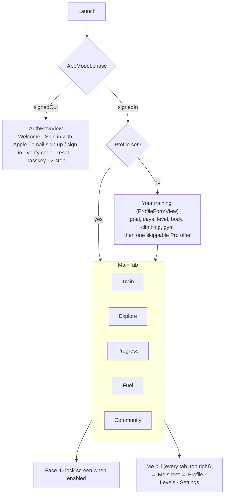

# iPhone app

SwiftUI, iOS 17+. Setup and build: [`ios/README.md`](../../ios/README.md). Watch, widgets and other devices: [devices.md](devices.md). Local files: [on-device-data.md](on-device-data.md).

## Code map

| Path | Content |
|---|---|
| `App/` | `MonkeyWorkoutApp` (entry, URL handling), `AppConfig` (API URL from Info.plist), `AppLock` (Face ID), `WhatsNew`, `HomeWidgetSync` (widget data + `monkeyworkout://` router), `Demo` (DEBUG demo data), `AppleCredentialCheck` |
| `Model/` | `AppModel` (auth phase, plan, logs, sync) split by feature into `AppModel+<Feature>.swift`; `LocalStore` (`state.json`), `FuelStore`, `MoveStore`, `LiftSets`, `ProStore` (StoreKit 2), `Community`, `WatchWorkouts` |
| `Views/` | One folder per area (below); shared pieces in `Views/Components` (`TabHeader`, `LensDayStrip`, `AutoSave`, `UndoClose`, `BodyMapView`, `BodyMap3DView`, `ExerciseImage`, `WhatsNewView`, `Theme`) |
| `Health/` | `HealthManager`: HealthKit reads (HRV, resting HR, sleep, steps, flights, workouts from other apps) and workout writes |
| `Notifications/` | Local reminders and check-ins, APNs registration, notification routing |
| `Watch/` | `WatchSync` (WatchConnectivity), `GarminSync` |
| `Packages/GymCore` | `WorkoutEngine` (plan generator, catalog, progression, Fuel, recipes, techniques) and `APIClient` |

## App structure

The app turns signed-in from the Keychain token before any network call, so every tab renders from the local cache on the first frame. Every tab header is a `TabHeader` with tab actions as 44 pt square tiles and the **Me pill** (level + photo) at the right.

## Tabs

### Train (`Views/Plan`, `WeekView`)

Customisable widget board (Edit Train, `TrainEditViews`, `TrainWidgets`): by default a week strip (`LensDayStrip`, opens on today), Coach Monkey card with week tiles (This week, phase, Ready), today's day card, Next up, then the week list.

- **Day card:** title with jump chip, action tiles (Add workout, Plan sport, Log climb, Freestyle, Log sport, Track live). Only today's session starts; later days show *Planned for <day>*; missed days offer *Log it* (`MissedViews`).
- **Skip a workout** (#643): long press the day card or a day in the strip (today or later this week) → *Skip today* / *Skip <day>*, at once with the Undo bar. Not moved: Next up goes to the next session, the strip shows a dim dash, the card says *skipped* with **Unskip**; once the day is over it is a skipped missed session (no catch-up prompt). `AppModel.skipSession/unskip/canSkip`, `skipWithUndo`, `LocalState.skipped`. Demo screen `train-skipped`.
- **Past day card** (`PastDayCard`, #592): every earlier day (done, rest, climbing, missed, last week) uses one card. Everything logged that day is a gradient row (`DayLogRow`): gym opens what was done, climbs and sports logged here open to edit (Log climb / Log sport in edit mode: saved over itself, Health workout replaced, Delete), Health sessions their page; long press = Edit + Delete. A missed session is a white *Log it* row. Tiles: **Workout** (a plan workout logged on that day as an extra, `MissedLogSheet(day:)`) and **Sport**, or **Log climb** on a climbing day with no climb yet. Demo screen `train-past-day`.
- **Session page** (`SessionView`, `SessionFlowViews`): warm-up, blocks, cool-down; edit before start (`EditExercisesSheet`), swap (`SwapExerciseSheet`, `ChangeExerciseSheet`), workout style and focus, superset fixes, time fit (`WorkoutTimeViews`). Session flow Edit (`SessionFlowSheet`) for plan sessions and generated quick extras (extras: this workout only, exercises picked again).
- **Player** (`WorkoutPlayerView`, `PlayerHero`, `PlayerQuickLog`, `PlayerLandscape`): one exercise at a time, fixed positions, no scrolling, kg × reps × effort entered once per set, rest timer, one Up next bar, Live Activity, pause / resume across app kills, finish early (`FinishEarlySheet`), close with Undo toast. Coach lines and studio voices (`WorkoutCoach`, `CoachVoices`), Watch lift sensor (`LiftSensorViews`), expert lifts.
- **Freestyle / build as you go** (`FreestyleViews`): pick → do → pick with Coach picks and a trail.
- **Plan tools:** Calendar with away periods and trips (`CalendarViews`), programmes and builder (`ProgrammeViews`, `ProgrammeBuilderViews`, Hyrox, snow), split, training methods and style, plan changes, variation, growth goals, fresh start after time away, readiness card.
- **Sports and climbing:** plan sport days, sport prep (before/after), track live or log, sport maps (`SportViews`, `SportPrepViews`, `SportMapViews`); climbing logs and Wall session (`ClimbViews`, `WallSessionViews`).
- **Ask Coach** (`AskCoach`, `CoachChatViews`): chat bubble on most screens; can propose a workout or an action.

### Explore (`Views/Library`)

Two-level menu (`ExploreMenu`): **Exercises** by muscle (2D/3D body map, `MuscleHero`), by machine, by type; **Ready-made** workouts and plans (`WorkoutLibraryViews`, shared library from members).

- Exercise page (`ExerciseDetailView`, `ExerciseJumpBar`): animation, technique cues (`TechniqueView`), position guide, variations (`VariationSheet`), history and records (`ExerciseHistoryView`), PR attempt (`PRAttemptView`), machine setup notes with photo (`MachineNoteViews`).
- Custom exercises (`CustomExerciseBuilderView`, pose designer) and custom workouts (`CustomWorkoutViews`, share to library).
- Gyms (`Views/Gyms`): gym finder and place search, equipment setup (`GymSetupView`, `EquipmentViews`), gym scan by photo, gym map with zones and *Taken?* (`GymMapViews`, `GymZoneViews`), *Not here* reports.

### Progress (`Views/Progress`)

Widget board (`ProgressBoardViews`) of gradient tiles: training (live tiles, consistency, trends, climbing, sports), programmes, body (`BodyHealthView`, measurements with help), records, badges, muscles; recent sessions strip → **History** (`HistoryView`). Levels and XP (`Views/Game`), weekly chest reveal, kind rewards.

### Fuel (`Views/Fuel`)

Day strip (past = counted, coming = plan) and the day's plate. Next planned meal with Ate it / Swap / Other, **Just ate** (+), meal plans (named plans, blocks, schedule, timeline lanes, `MealPlanViews`, `MealBlockViews`), recipes (`RecipeViews`, share), pantry and shopping basket with budget (`PantryViews`, `BudgetViews`), food scan (barcode, label text, Snap the fridge) with check list (`ScanCheckViews`), supplements with schedules or "only when I pick it" (`SupplementViews`), meal replacements and supplements from a brand list with variants (`ProductCatalogSheet`, engine `ProductCatalog`) shown as **Mine** in Just ate (`MineStrip`) and in a planned meal's Swap (Recipes / Mine, every planned meal of that kind), water with pace and reminders (`WaterViews`).

### Community (`Views/Community`)

Feed of members' wins (`PostCard`, cheers `ReactionBar`), Trained today row, moment cards, share a win (`ShareWinView`), find members (`FindMembersView`), member pages, follow / block / report, your profile (`ProfileView`, one page for account and community). Joining needs accepting the guidelines.

## Me sheet and Settings (`Views/Account`)

Me sheet: photo, name, @nickname, level bar → **Your profile**, Levels, Settings. Settings (`AccountView`) has a chapter bar and search:

| Chapter | Contents |
|---|---|
| You | Profile, body, pronouns and coach call name, your gym (`YourGymCard`) |
| Training | Training preferences, coach settings and voices, auto-next, lift sensor |
| Watches | Apple Watch home style and options (`WatchHomeView`), Garmin pairing (`GarminView`) |
| Look & apps | App style, Home Screen widgets (`HomeWidgetsView`), MonkeyGrade link |
| Account | Email, password, security (passkeys, 2-step, `SecurityViews`), devices, Face ID lock, MonkeyWorkout Pro (`ProView`), export, sign out (all), delete account |
| Help | What's new, report a problem (also shake to report and on errors, `ReportProblem`), legal links |

## Cross-cutting behaviour

- **Edit screens auto-save** (`.autoSave(...)`); new records keep Save + draft. Closing with data closes and shows an Undo toast, no confirmation dialogs.
- **Sync:** every change goes to `state.json` first, then the outbox syncs with silent backoff and on network return ([../api/README.md](../api/README.md#sync-protocol)).
- **Notifications:** session reminders, missed-session check-ins (train today / pick another day), water nudges, badges, followed members' achievements (APNs), quiet hours.
- **HealthKit:** readiness (HRV, resting HR, sleep), steps and flights, workouts written for app and Watch sessions, workouts from other watches matched to the day's session.
- **Pro:** StoreKit 2 purchases sent to the server; entitlement decides access to Pro features when enforced ([../subscriptions.md](../subscriptions.md)).
- **Deep links** `monkeyworkout://`: `session/<id>`, `start/<id>` (today's session opens in the player), `progress`, `level`, `fuel`; anything else opens Train.
- **What's new** sheet once per release from `Resources/WhatsNew.json`.
- **Demo mode** (DEBUG): `-demo -demoScreen <name>` starts with sample data and no network; CI screenshots use it.

## Design rules

Bold gradient cards (Explore look): icon tile left, heavy type, big number right, square shapes, no grey list screens. Sheets close with X top right. Every tappable-looking element leads somewhere. Visible UI changes start with 2–3 mockups for the owner to pick.
