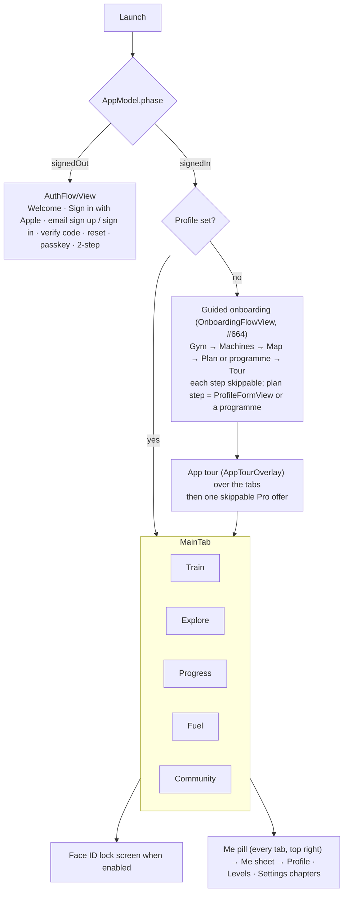

# iPhone app

SwiftUI, iOS 18+. Setup and build: [`ios/README.md`](../../ios/README.md). Watch, widgets and other devices: [devices.md](devices.md). Local files: [on-device-data.md](on-device-data.md).

## Code map

| Path | Content |
|---|---|
| `App/` | `MonkeyWorkoutApp` (entry, URL handling), `AppConfig` (API URL from Info.plist), `AppLock` (Face ID), `WhatsNew`, `HomeWidgetSync` (widget data + `monkeyworkout://` router), `Demo` (DEBUG demo data), `AppleCredentialCheck` |
| `Model/` | `AppModel` (auth phase, plan, logs, sync) split by feature into `AppModel+<Feature>.swift`; `LocalStore` (`state.json`), `FuelStore`, `MoveStore`, `LiftSets`, `ProStore` (StoreKit 2), `Community`, `WatchWorkouts` |
| `Views/` | One folder per area (below); shared pieces in `Views/Components` (`TabHeader`, `LensDayStrip`, `AutoSave`, `UndoClose`, `BodyMapView`, `BodyMap3DView`, `ExerciseImage`, `WhatsNewView`, `Theme`) |
| `Health/` | `HealthManager`: HealthKit reads (HRV, resting HR, sleep, steps, flights, workouts from other apps) and workout writes |
| `Notifications/` | Local reminders and check-ins, APNs registration, notification routing |
| `Watch/` | `WatchSync` (WatchConnectivity), `GarminSync` |
| `Packages/GymCore` | `WorkoutEngine` (plan generator, catalog, progression, Fuel, recipes, techniques) and `APIClient` |

## App structure

The app turns signed-in from the Keychain token before any network call, so every tab renders from the local cache on the first frame. Every tab header is a `TabHeader` with tab actions as 44 pt square tiles and the **Me pill** (level + photo) at the right.

### Onboarding (`Views/Onboarding`, #664)

- **Guided flow** (`OnboardingFlowView`, mode `newMember` / `rerun` / `single(step)`): Gym (`GymPicker`, add choices open) → Machines (`EquipmentSheet`) → Map (zones + `FloorPlanSheet`) → Plan (Build my plan = `ProfileFormView(newMember:)` without the gym section, or one of 4 one-tap programmes; re-run adds Keep my plan) → Tour. Skip on every step; a new member's skipped plan step makes the draft a starter plan. Nothing is saved before the plan step; `AppModel.onboardingOpen` keeps the flow up after it.
- **App tour** (`AppTourOverlay`, `AppTour.steps`): six stops (Train, Explore, Progress, Fuel, Social, Coach Monkey), switches `model.tab`, Next / Skip tour. The first Pro offer waits for its end (`proAfterTour`).
- **Set-up card** (`SetupCard`, first in Train's notice slot): steps not done, each opens the step on its own; ✕ hides it (`hideSetupCard`). State `SyncedProfile.onboarding` (engine `OnboardingProgress`: `done`, `cardHidden`); nil = member from before #664, no card.
- Demo screens `onboarding-gym`, `onboarding-machines`, `onboarding-map`, `onboarding-plan`, `onboarding-tour`, `app-tour`, `train-setup`, `onboarding-hub`.

## Tabs

### Train (`Views/Plan`, `WeekView`)

Customisable widget board (Edit Train, `TrainEditViews`, `TrainWidgets`): by default a week strip (`LensDayStrip`, opens on today), Coach Monkey card with week tiles (This week, phase, Ready), today's day card, Next up, then the week list.

- **Day card:** title with jump chip, action tiles (Add workout, Plan sport, Freestyle, Log sport, Track live). On a **sport day** (#658) the day's sport (`Profile.sport(onWeekday:key:)`: a dated sport day or trip beats the weekly climbing day) shows as one **sport block** in its colours (`SportDayHero`): name, *Change ›* menu (change sport / edit sport day, Gym around it), Track live · Log · Prep today (Log on earlier days; climbing → climb log, Prep → Wall session), gym tiles (Add workout, Freestyle) under it; the separate prep and Wall session bars are hidden then. Demo screen `train-sport-day`. Only today's session starts; later days show *Planned for <day>*; missed days offer *Log it* (`MissedViews`).
- **Same day actions everywhere** (#671, design A from `day-card-consistency/proposals.png`): every coming day card, this week or a later one, ends with three tiles in fixed spots, and the strip day's long press offers the same: **workout day** Move · Plan sport · Skip (done days keep the row dimmed); **sport day** Workout · Change · Rest day; **rest day** Workout · Plan sport · Recover. Workout = Add workout this week, *move one here* (`MoveHereSheet`) in a later week. Later weeks: moves are stored like this week's (`SessionMove.weekOf` = that Monday, `AppModel.laterMoves` → `PlanCalendar.weeks(laterFixed:)`), skips in `LocalState.skippedAhead` (Monday → ids, they become `skipped` when the week starts). **Rest day** (`sportOffFlow`): just this day (`Profile.sportOff` day keys: no weekly sport, climbing or trip that day), every <weekday> (weekly sport or climbing loses it) or the whole trip; Undo toast. Today's prep / Wall session bars only show while the card shows today (#670).
- **Skip a workout** (#643): long press the day card or a day in the strip (today or later this week) → *Skip today* / *Skip <day>*, at once with the Undo bar. Not moved: Next up goes to the next session; a day with nothing else on it becomes a **rest day** (#698, design A from `skipped-rest-day/proposals.png`): the strip shows the moon (or the day's sport), the card is the rest-day card (`RestDayCard(skipped:)`, also for later weeks) with a struck-through *Pull skipped* line and a lime **Unskip** chip; today's skipped day is the default card; once the day is over it is a skipped missed session (no catch-up prompt). `AppModel.skipSession/unskip/canSkip`, `skipWithUndo`, `LocalState.skipped`. Demo screen `train-skipped`.
- **Past day card** (`PastDayCard`, #592): every earlier day (done, rest, climbing, missed, last week) uses one card. Everything logged that day is a gradient row (`DayLogRow`): gym opens what was done, climbs and sports logged here open to edit (Log climb / Log sport in edit mode: saved over itself, Health workout replaced, Delete), Health sessions their page; long press = Edit + Delete. A missed session is a white *Log it* row. Tiles: **Workout** (a plan workout logged on that day as an extra, `MissedLogSheet(day:)`) and **Sport**, or **Log climb** on a climbing day with no climb yet. Demo screen `train-past-day`.
- **Session page** (`SessionView`, `SessionFlowViews`): warm-up, blocks, cool-down; edit before start (`EditExercisesSheet`), swap (`SwapExerciseSheet`, `ChangeExerciseSheet`), workout style and focus, superset fixes, time fit (`WorkoutTimeViews`). Session flow Edit (`SessionFlowSheet`) for plan sessions and generated quick extras (extras: this workout only, exercises picked again).
- **Player** (`WorkoutPlayerView`, `PlayerHero`, `PlayerQuickLog`, `PlayerLandscape`): one exercise at a time, fixed positions, no scrolling, kg × reps × effort entered once per set, rest timer, one Up next bar, Live Activity, pause / resume across app kills, finish early (`FinishEarlySheet`), close with Undo toast. Coach lines and studio voices (`WorkoutCoach`, `CoachVoices`), Watch lift sensor (`LiftSensorViews`), expert lifts.
- **Timers** (#622, `WodTimerViews`, Workout library): kind tiles (Tabata, EMOM, AMRAP, For time, Rounds, Boxing) open the builder (`WodBuilderSheet`: numbers, moves, punches on Watch); saved timers (`WodStore`, `wod-timers.json`) auto-save, long press = Edit / Delete with Undo. **Big screen** (`BigScreenTimerView`): full screen, turns sideways, keeps the screen on, huge countdown, round, moves, sound + haptic cues; the Watch's double tap starts and pauses it.
- **Swim** (#624, `SwimPlanViews`, Workout library): plans Learn to swim / 1 km non-stop / 2 km (8 weeks, 2–3 swims a week on days without lifting, last swim = non-stop test, `SwimPlan`), next swim and the week's swims (`SwimWorkoutSheet`: sets with send-offs), **Start on Watch** on a swim day, **Pool + gym**: a swim warm-up or finisher on a gym day (`SwimBlockCard`, also on the session page; tap cycles 10/15/20/30′, chip switches warm-up / finisher, long press removes with Undo), pool length, open water buddy alert minutes (`SwimStore`, `swim.json`).
- **Freestyle / build as you go** (`FreestyleViews`): pick → do → pick with Coach picks and a trail.
- **Plan tools:** Calendar with away periods and trips (`CalendarViews`), programmes and builder (`ProgrammeViews`, `ProgrammeBuilderViews`, Hyrox, snow), split, training methods and style, plan changes, variation, growth goals, fresh start after time away, readiness card.
- **Recover** (`RecoveryViews`, `AppModel+Recovery`, engine `Recovery`, #619): today's and every coming rest day (later weeks too, #659) show a ~12′ mat routine for the area trained hardest in the last 7 days (Hips & back, Legs, Shoulders & chest or Full body) with the days that loaded it; Start opens its session page. On a "Take it easier" readiness day with a strength session, a **Readiness swap** card in the notice slot offers **Swap** (session moves to the next free day this week, today becomes a recover day) or **Keep** (hidden until tomorrow). Example, own and shared workouts without a cool-down get a 5′ **Cool-down** finisher (4 stretches for what they loaded most).
- **HIIT** (#693, `HiitViews`, `HiitPlayerView`, engine `Hiit`): **A** Training profile → **HIIT** (also Explore → HIIT → *In your plan*) sets `Profile.hiit` (`HiitPlan`: 0–3 days a week, Tabata finisher on lifting days, low impact). `Hiit.addDays` (in `Generator.generateWeek`, before gyms and runs) appends HIIT days as conditioning sessions with their own ids on free days away from leg days and from each other (none when no day is free, unscheduled when the plan has no weekdays); formats rotate weekly (Engine burner Tabata + EMOM + AMRAP, Thirty-thirty, Pyramid power, Race the clock), week 4 is *Easy intervals*, low readiness eases them (`HiitWorkout.eased`). Finisher replaces a lifting day's cardio block with a 4′ Tabata (F1/F2). **B** Explore → Ready-made → **HIIT**: format tiles (Tabata, EMOM, AMRAP, For time, Pyramid, 30/30) open `HiitBuilderSheet` (length 10/15/20/30′, kit No kit / Dumbbells / Kettlebell / My gym, impact, moves with Reshuffle) → **Do today** (player), **Add to day** (`addExtra` with the session as `generated`), **Save** (per device, `@AppStorage` `savedHiits`). Library ids are the spec (`example-hiit-<format>-<min>-<kit>-<std|low>-<shuffle>`), resolved by `AppModel.standaloneSession`. **C** a session with `Session.hiit` opens `HiitPlayerView` instead of the classic player: phase colour full screen, countdown (For time counts up), move animation, round segments, Watch heart rate, Up next bar with Skip, Pause / +1 round (AMRAP) / Done (For time), 3-2-1 / work / rest beeps and haptics. Finish logs to History (sets = intervals done, skipped before half-way not counted) and Health as HIIT; X with work done saves and shows Undo. Demo screens `explore-hiit`, `hiit-builder`, `hiit-player`, `train-hiit`.
- **Daily routines** (#689, `RoutineViews`, `AppModel+Routines`, engine `Routine`): a **Daily** row under Next up on every day, **the member's choice** (#696 B): until picked, a slim **Add a daily routine** prompt (✕ hides it for good, `@AppStorage` `dailyRoutineSuggestion`) opens `DailyRoutinePicker` (square tiles, up to two, lengths; demo screen `daily-pick`); members who already did a routine keep those (`AppModel.usedRoutines`). Two square tiles with three length chips, a streak (days in a row from history, any length) and a check when done today; tap opens the routine's session page. Long press: **Swap for…** another routine, **Choose routines…**, **Remove from Daily** (#703) or **Hide daily row**. Picks and lengths are per device (`@AppStorage` `dailyRoutines`, `dailyRoutineLengths`). Explore → Ready-made → **Routines** lists every built-in (Full-body stretch 5–30′, Daily hangs 5–20′, Morning mobility, Desk reset, Before bed) with All / Stretch / Hang / Mobility filters, every length and a pin (**Show on Train**, also brings a hidden row back; its ✓ takes it off again, #703). Routines scale to the length: more moves, then longer holds or a second round. Daily hangs: 10 s on / 50 s off on 20 mm, half crimp and open hand in turn, 40–60 % bodyweight, effort 3–4/10; on a climbing day the tile says *Climb day · keep it easy*. Session ids `example-routine-<routine>-<minutes>`. Demo screen `explore-routines`. **More routines, own routines, add card** (#732): 11 built-ins (adds Hip opener, Shoulder care, Roll out, Runner's legs, Wrists & fingers, Splits & straddle; filters All / Stretch / Hang / Mobility / Recovery / Mine). **Own routines** (`MyRoutineEditor`, `MyRoutineViews`): custom workouts with `CustomWorkout.routine` (`RoutineLook`: palette colour 0–5, icon), keyed on Train by their session id (`DailyRoutine` wraps built-ins and own ones; `AppModel.myRoutines`, `dailyRoutines`, `dailyTiles`); excluded from My workouts in the library; session plays as one mobility block. **Train add card** replaces the slim prompt: `DailyStarterCard` (A) until anything is picked or done and not closed (`dailyRoutineOffer`), then `CoachRoutineCard` (C, `Routine.coachPick` from today's session focus, rest day or climbing day; ✕ = not today, three ✕ stop it, `dailyRoutineCoach` = `<day>:<closes>`). Demo screens `daily-offer`, `routine-builder`.
- **Sport season blocks** (#620, engine `Programme+Season`, `SportAddOn`; app `SportAddOnViews`, `AppModel+SportAddOn`): Explore → Programmes opens with **Get ready for…** (Ski, Padel, Climb, Run, Surf, Football tiles → Snow ready, Climber's power or a `season-*` programme whose page asks when the season starts and fits 5–12 weeks to it). **Sport add-on**: a 15′ sport block added to the week's first 1–3 strength sessions (appended to their mobility block or as one), set under the tiles (sessions a week, remove) or from the Coach's card in the notice slot when a sport was logged 3+ times in 14 days (**Add 2× week** / **No**, hidden 30 days). Stored in `SyncedProfile.sportAddOn`.
- **Skill tree** (#621, engine `Skills`, `SkillProgress` in `SyncedProfile.skills`; app `SkillViews`, `AppModel+Skills`): Explore → Programmes → **Skill tree**: Pull, Push, Legs, Balance & core branches of square nodes (passed lime, current white, locked dim). A node opens its **test** (max reps with − / +, or a hold timer); reaching the target unlocks the next level. **Skill of the month**: one node, a 10′ practice (`skill-practice-*` template) offered on Train on Monday, Wednesday and Friday with the month's days done / goal and a chest when the goal is met.
- **Run & cardio** (`RunViews`, `AppModel+Runs`, engine `RunPlanner`, #618): Training profile → **Run & cardio** sets a race (5K, 10K, half; date, goal time, name, 2–4 runs a week) or **Hybrid** (two Zone 2 sessions, bike/row/run, and one interval day). Runs are placed around this week's lifting (long run Saturday, never on or the day after a legs day; hard runs not after legs; gym-free days first) through Base, Build, Peak, Taper and race week, paced from the goal time. Train shows the **goal race card** (countdown, M–S strip with lift / run / rest, today's run) under Next up. A run opens **RunSessionSheet**: its steps, **Start** (design C: MonkeyFit player on the Watch or Apple Workout, *Remember for running* per sport, `RunStartChoice`) and **Send to Workout app** (#610, WorkoutKit: `AppleWorkoutPlan` builds a `CustomWorkout` with warm-up, interval blocks with iterations, cool-down, pace or heart-rate zone alerts; `workoutPreview` shows Apple's sheet). A run is done when Health has a run, ride or row of half its time that day (Apple's Workout app included). Lifting and runs are planned as one week (#685): on a run day the workout card shows **Lift → run → climb** numbered in order (`DayComboRow`) with the Coach's note (the run replaces the lift's cardio, leg work −1 set before a long or hard run).
- **Where I train** (`WeekPlacesViews`, #684): with more than one saved gym, Training profile → Week shows one row per weekday with a chip per gym (one per day, tap again for none) and Climb. A day with a gym is a gym day; `SyncedProfile.placedProfile` turns `Profile.dayPlaces` into `dayKits` (each gym's equipment and zones) and the planner builds that day's workout for it. The day card shows **Lift · <gym>**. **Just this day** (#700): the day card's **📍 gym ▾** chip (`PlaceMenuChip`) picks a gym for one day (`SyncedProfile.placeOnDay`, day key → gym id, applied by `planProfile` through `Profile.placing`) or every week (`setPlaceEveryWeek`). The chip shows on every workout day this week and in the long-press menu (`PlaceMenuItems`, #705); **Home** is always a choice (`SavedGym.builtInHome`, bodyweight, when no home gym is saved); on a Calendar travel day the trip sets the place. Daily routines carry a **Where** (Home / Gym / Anywhere, `RoutinePlace`, device prefs `dailyRoutinePlaces`).
- **Bike sensors** (Settings → Watches, `BikeSensorsView`, `AppModel+Bike`, #623): FTP (stepper, W/kg), the 7 power zones in watts, last test and retest due (6 weeks), how to pair sensors and run the FTP test on the Watch. Stored in `SyncedProfile.bikeFTP` / `bikeFTPTestedAt`.
- **Life stages** (#625, engine `LifeStage`, `LifeStageCheckIn` in `SyncedProfile.lifeStage`; app `LifeStageViews`, `AppModel+LifeStage`): Explore → Programmes → **Life stages** cards (Pregnancy, Postpartum, 50+, Back to training). The page starts with a **check-in** (due date → trimester, birth date, weeks off) and a **doctor's OK** toggle that unlocks Start; **Swapped for you** lists the safety guard's swaps with why; **Pace by feel**. While one runs, `lifeGuarded` swaps risky moves in the plan (uids kept, block note says what and why), sets every working set to the talk test, and the player hides PR attempts.
- **Live group sessions** (#626, `LiveRoom`, `LiveViews`, APIClient `Live.swift`): Community shows **Gym buddies** (invites to pair, paired buddies with their live set and 🔥 🍌 🦍 cheers) and the **Week challenge** card. A member page has **Gym buddy** (invite / accept / unpair); the invite and the pairing arrive as push `buddy_invite`, which opens that member's page. While the player runs, `LiveRoom.player` sends the current set (`PUT /v1/community/live`, on state change, otherwise at most every 5″, refreshed every 2′) only when a paired buddy exists or the challenge runs; every 15″ it polls cheers and buddies' sets and shows them as `BuddyToast` over the player and on the Watch (`WatchSync.sendBuddy`). **Week challenge** (`ChallengeRoomView`): `WeeklyChallenge.wod(for:)` (LiftSensor) gives the ISO week's AMRAP 12′, START runs it on `BigScreenTimerView` (sent live with `challengeWeek`), then the score sheet saves rounds + reps; the leaderboard refreshes every 20″ while open.
- **Sports and climbing:** plan sport days, sport prep (before/after), track live or log, sport maps (`SportViews`, `SportPrepViews`, `SportMapViews`); climbing logs and Wall session (`ClimbViews`, `WallSessionViews`).
- **Around sport days** (`AroundSportViews`, #658, was Around climbing days #47): Settings, the Wall session and Sport prep pages. One choice for all sports (day before / day after: Keep it light, Strong elsewhere, Rest, No adjustment; on sport days: Sport only, Gym allowed), stored in `Profile.sportBefore/sportAfter/sportSameDay`; **Your sports** rows open a sport's own page (sport strip, cards worded from its load by engine `SportAround`: run → "Strong upper body", climbing → "Strong push or legs") to differ, *Use the default* clears it. Climbing keeps `climbBefore/climbAfter/climbSameDay` and the Wall session toggle; other sports their `SportPlan`. Diving keeps rest the day after and no same-day gym. Free (Pro `.climbing` = Wall session). Demo screen `around-sport`.
- **Ask Coach** (`AskCoach`, `CoachChatViews`): lime 🐵 tile at the top right of every tab (`CoachHeaderTile`), sparks on key cards; can propose a workout or an action.
- **On-device Coach** (`OnDeviceCoach`, #608): on iOS 26+ iPhones with Apple Intelligence (`SystemLanguageModel`), short training questions (`CoachRoute.onDevice`: no workout asked for) are answered by the on-device model with an **⚡ On device** badge (`OnDeviceBadge`): offline, nothing sent, no daily limit. It also answers when the server Coach is off, out of messages or unreachable. The finish screen shows a **recap card** (`RecapCard`, engine `WorkoutRecap`: two lines + a tip from the record vs the last time each lift was done), reworded by the model (`RecapDraft`, `@Generable`) when available. Settings → Ask Coach → *Quick answers on device* (`askCoach.onDevice`).
- **Voice logging** (#617): the player mic and Ask Coach use `SpeechAnalyzer` + `SpeechTranscriber` on iOS 26 (language assets downloaded in the background the first time, `SFSpeechRecognizer` meanwhile and on iOS 18–25). `VoiceCommand.set` logs a set from one sentence: "eight at eighty", "8 reps at 82.5 kg", "100 kilos for 5"; number words fold into numbers ("sixty two point five").
- **Visual Intelligence** (#617, `VisualLookup.swift`): `MachineVisualQuery` (`IntentValueQuery` on `SemanticContentDescriptor`) turns the camera's labels into exercises for that machine (`MachineMatch`); `OpenExerciseIntent` opens the page (`ExerciseLaunch` → sheet on `RootView`).
- **Tips** (`HiddenGestureTips`, TipKit, #617): Hold 🐵 to talk, Log a set by voice (player mic), Fix a set (set chips, after the first set). Once each, daily at most; hidden in demo mode.

### Explore (`Views/Library`)

Two-level menu (`ExploreMenu`): **Exercises** by muscle (2D/3D body map, `MuscleHero`), by machine, by type; **Ready-made** workouts, HIIT (`HiitViews`, #693), routines (`RoutineViews`, #689) and plans (`WorkoutLibraryViews`, shared library from members).

- Machine chips (`MachineChips`, `MachineViews`): **My gym** pinned on the left as a sunset tile (`GymChipTile`, `ExploreGymViews`, #662): gym name and machine count, tap = only what the gym has, ▾ = gym sheet (`ExploreGymSheet`: **Gym map** → `FloorPlanSheet`, **Here** and **Add missing** → `EquipmentSheet` with zones, saved by `AppModel.setGymEquipment`). Other chips slide under it.
- Exercise page (`ExerciseDetailView`, `ExerciseJumpBar`): animation, technique cues (`TechniqueView`), position guide, variations (`VariationSheet`), history and records (`ExerciseHistoryView`), PR attempt (`PRAttemptView`), machine setup notes with photo (`MachineNoteViews`).
- Custom exercises (`CustomExerciseBuilderView`, pose designer) and custom workouts (`CustomWorkoutViews`, share to library).
- Gyms (`Views/Gyms`): gym finder and place search, equipment setup (`GymSetupView`, `EquipmentViews`), gym scan by photo, gym map with zones and *Taken?* (`GymMapViews`, `GymZoneViews`), *Not here* reports.
- **Your own gym** (#680, `OwnGymViews`): Search by name (`GymPicker`) and Find a gym (`GymFinderView` with `onPick`) end with `AddOwnGymRow` (*Add "<name>"*); long-press the finder map drops a pin. `OwnGymSheet`: name required, address + pin optional (tap map, typed address geocoded, Use my location; pin reverse-geocoded) → `SavedGym.customRef(name:address:latitude:longitude:)` (`custom:` id, private, never in gym memory) → `GymSetupView`. Demo screen `own-gym`.

### Progress (`Views/Progress`)

Widget board (`ProgressBoardViews`) of gradient tiles: training (live tiles, consistency, trends, climbing, sports, **Zone 2 this week**: minutes per heart-rate zone over every workout from every app with a 150′ goal ring, `ZoneWeekCard`, #609 C; Apple's own zone times on iOS 27, else heart-rate samples sorted into the zones), programmes, body (`BodyHealthView`, measurements with help), records, badges, muscles, **mood vs training** (`MoodWidget`, #614 B: effort bars and the finish faces of the last 10 workouts); recent sessions strip → **History** (`HistoryView`). Levels and XP (`Views/Game`), weekly chest reveal, kind rewards.

### Fuel (`Views/Fuel`)

Home (#733, `FuelHomeViews`): one look for everyone (the Day / Timeline / Portions picker and the tool row are gone; "Hide numbers" in Fuel settings shows palms and cups instead of grams). Header Fuel + `CoachHeaderTile` + `MePill`, the day strip (opens on today), then the **tank** (`FuelTankCard`: load, headline, % fuelled, protein / carbs / water / caffeine squares; water adds a glass per tap, hold opens `WaterSheet` with every glass; caffeine opens `FuelStackSheet`), **LOG WHAT I ATE** (`FuelLogButton` → the **Log** sheet, `JustAteSheet`), the next meal (`FuelNextCard`), and **Kitchen** (`FuelKitchen`: What I have, Meal plan, Groceries with basket cost, My stack as squares; Recipes, Fuel week, Learn, Settings chips). The Log sheet opens with **Magic Snap** (`MagicSnapCard`, Pro): one photo, `food-scan` `mode: auto` says `kind` meal or stock; `MagicSnapSheet` then becomes Snap my plate (`PlateScanSheet`, `preset`) or Snap the fridge (`FoodPhotoScanSheet`, `preset`); Plate / Fridge / Barcode chips open one kind directly. Demo screens `fuel-log`, `fuel-snap`.

First open (#686): no forced sheet; the day shows with default pointers and a **Set up Fuel** card (`FuelSetupCard`) opens `FuelSetupView` (✕ = later, Save my fuel saves); Later / ✕ hides the card with an Undo bar (`FuelStore.saved.setupCardHidden`), Settings → You → Onboarding keeps a Fuel row. Day strip (past = counted, coming = plan) and the day's plate. Next planned meal with Ate it / Swap / Other, **Just ate** (+), meal plans (named plans, blocks, schedule, timeline lanes, `MealPlanViews`, `MealBlockViews`), recipes (`RecipeViews`, share), pantry and shopping basket with budget (`PantryViews`, `BudgetViews`), food scan (barcode, label text, Snap the fridge) with check list (`ScanCheckViews`), supplements with schedules or "only when I pick it" (`SupplementViews`), meal replacements and supplements from a brand list with variants (`ProductCatalogSheet`, engine `ProductCatalog`) shown as **Mine** in Just ate (`MineStrip`) and in a planned meal's Swap (Recipes / Mine, every planned meal of that kind), water with pace and reminders (`WaterViews`). **Just ate** also logs plain foods (#710, `FoodPlateViews`): search finds foods (`FoodBook.search`, plurals match) as well as recipes, quick food chips per meal (`FoodBook.quick`, recent foods first) put them on a plate (`FoodPlateCard`, ½-step amounts, totals, milk nudge for cereal), **Log <meal>** stores them on the meal tick (`FuelDayLog.log`, `FuelTick.foods/macros/caffeineMg`; foods next to a ticked recipe use `FuelDayLog.foodKey`), portions come from the day's food grams so small items add up; **Save as a usual** keeps the plate (`FoodUsual`, `FuelStore.saved.usuals`, `UsualStrip`, one tap logs it, hold to delete). Foods carry `caffeine` (mg/100 g): logged coffee, tea, cola and energy drinks join the caffeine meter, shown even with no supplement stack. Demo screen `fuel-plate`. **Snap my plate** (#723, Pro, now the Plate chip under Magic Snap): photo of a cooked meal → `food-scan` `mode: plate` → `PlateScan` (dish, foods with grams, S–XL size, eaten share ¼–All, totals with caffeine) → `PlateScanSheet` logs it by weight (`FoodServing(foodId:grams:of:)`, shown as ≈ g), keeps unknown foods (`FuelStore.keep`) and can save it as a usual (*Save as my dish*). Demo screen `fuel-snap-plate`.

### Social tab (`Views/Community`, labelled Community until #707)

Layout (#738, `SocialStories`): header (Coach, **+** → `ShareHubSheet`: Win, Plan, Meal, Tip; Me pill), a square **story row** (`SocialStoriesRow`: Live / Invites → `BuddiesScreen`, week challenge → `ChallengeRoomView`, each member who trained today (`TrainedToday.today`) → full-screen `StoryViewer` paging their posts, then **Invite** → `InviteView`), chips **For you · Following · People** (`SocialChips`, People → `FindMembersView`), then one feed: For you mixes member plans into posts (`CommunityFeedScope.mixed`, one plan after every third post). Each post: compact cheers (`ReactionBar`: tap 💪, hold for all six) and one action (`PostAction`: **Beat it** on a member's personal best → `PRAttemptView`, **Save to Fuel** on a member's book recipe → Fuel favourites). Your own posts: Me → Your profile. Plans (`SharedPlanView`, `SharePlanSheet`, store `SharedPlans`, APIClient `SharedPlans.swift`): member-made programmes shared via `/v1/community/programs`, copied into My programmes (`Programme.copy`). Tips (`PostTipSheet`): note posts with style `tip:train|fuel`. Moment cards, share a win (`ShareWinView`), find members (`FindMembersView`), member pages, follow / block / report, your profile (`ProfileView`, one page for account and community). Joining needs accepting the guidelines.

**Invite a friend** (#745, `InviteViews.swift`, store `ReferralStore`, APIClient `Referrals.swift`): `InviteView` shows the member's code (`GET /v1/referrals/me`, cached per account in `DeviceCache` `referrals.json`), share buttons (Messages `sms:`, WhatsApp `wa.me`, a `StoryPoster.invite` image with a QR code, the share sheet), Joined / Pro / XP tiles, **Got a friend's code?** (`POST /v1/referrals/redeem`, while `canRedeem`), the `InviteReward` ladder and Gym buddies. Ladder XP (and +200 for joining with a code) is added to the level in `AppModel.game`; the Iron and Titan steps show `AppIconPicker` before those ranks. Pro steps only show as earned: they are delivered as App Store offer codes. **Story posters** (`StoryPoster`, `StoryShareButton`): 1080 × 1920 images rendered with `ImageRenderer`, with the invite code, on the workout summary (`SummaryView`), PR result (`PRAttemptView`) and week chest (`ChestReveal`). **Socials**: `SocialsEditor` in Your profile (auto saved via `PUT /v1/community/me/socials`), `SocialTiles` on `MemberView`.

## Me sheet and Settings (`Views/Account`)

Me sheet (#736): hero with photo, name, @nickname and **Edit ›** → **Your profile**; its level bar → Levels; then six square Settings chapter tiles (`SettingsChapter.summary`) opening `AccountView(start:)` at that chapter, and **All ›** for Settings at the top. Settings (`AccountView`) has a chapter bar and search:

| Chapter | Contents |
|---|---|
| You | Profile, body, pronouns and coach call name, your gym (`YourGymCard`), **Onboarding** (`OnboardingHubView`: run it all again or one step, tour, Fuel set-up, set-up card on/off) |
| Training | Training preferences, coach settings and voices, auto-next, lift sensor |
| Watches | Apple Watch home style and options (`WatchHomeView`), Garmin pairing (`GarminView`) |
| Look & apps | App style, Home Screen widgets (`HomeWidgetsView`), MonkeyGrade link |
| Account | Email, password, security (passkeys, 2-step, `SecurityViews`), devices, Face ID lock, MonkeyWorkout Pro (`ProView`), export, sign out (all), delete account |
| Help | What's new, report a problem (also shake to report and on errors, `ReportProblem`), legal links |

## Cross-cutting behaviour

- **Edit screens auto-save** (`.autoSave(...)`); new records keep Save + draft. Closing with data closes and shows an Undo toast, no confirmation dialogs.
- **Sync:** every change goes to `state.json` first, then the outbox syncs with silent backoff and on network return ([../api/README.md](../api/README.md#sync-protocol)).
- **Notifications:** session reminders, missed-session check-ins (train today / pick another day), water nudges, badges, followed members' achievements (APNs), quiet hours.
- **HealthKit:** readiness (HRV, resting HR, sleep), steps and flights, workouts written for app and Watch sessions, workouts from other watches matched to the day's session. The finish screen saves **effort** 1–10 on the workout (`EffortCard`, prefilled from RIR, `HKQuantityType(.workoutEffortScore)` related with `relateWorkoutEffortSample`, counts in Apple Training Load) and the **mood** faces as a State of Mind (`FeelRow`, `HKStateOfMind`); shared helper `WatchShared/HealthEffort.swift`.
- **Ring through Silent** (iOS 26, `Notifications/TimerAlarms.swift`, AlarmKit): off by default, asked once the first time a rest or timed block runs, toggle in Settings → Reminders & alerts. End of rest rings with Start set / +30 s (`AddRest30Intent`); timed blocks (Tabata, EMOM, rounds) ring at each block's end. Scheduled from `LiveWorkout` with the Live Activity state; replaces the rest-over notification while on.
- **Pro:** StoreKit 2 purchases sent to the server; entitlement decides access to Pro features when enforced ([../subscriptions.md](../subscriptions.md)).
- **Deep links** `monkeyworkout://`: `session/<id>`, `start/<id>` (today's session opens in the player), `progress`, `level`, `fuel`; anything else opens Train.
- **What's new** sheet once per release from `Resources/WhatsNew.json`.
- **Demo mode** (DEBUG): `-demo -demoScreen <name>` starts with sample data and no network; CI screenshots use it.

## Design rules

Bold gradient cards (Explore look): icon tile left, heavy type, big number right, square shapes, no grey list screens. Sheets close with X top right. **Liquid Glass** (iOS 26, `LiquidGlass.swift`): glass only on system chrome, the floating tab bar (`glassTabBar`, never minimises, #677) and sheet edges (`glassSheetBackground` instead of `Theme.bg` on a sheet's content); cards, the player and its lime Log stay solid, no glass capsules over large titles. Screens with a pinned search, chips or jump bar use `solidNavBar()` + `solidPinnedHeader()`: solid title bar and pinned row as one block, nothing shows through (#727). Every tappable-looking element leads somewhere. Visible UI changes start with 2–3 mockups for the owner to pick.
