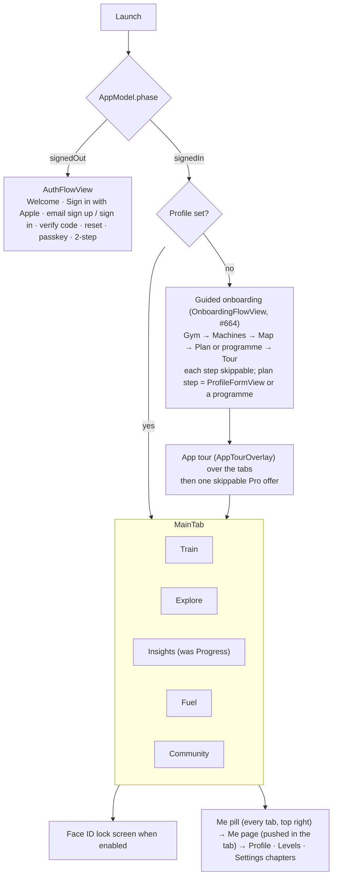

# iPhone app

SwiftUI, iOS 18+. Setup and build: [`ios/README.md`](../../ios/README.md). Watch, widgets and other devices: [devices.md](devices.md). Local files: [on-device-data.md](on-device-data.md).

## Code map

| Path | Content |
|---|---|
| `App/` | `MonkeyWorkoutApp` (entry, URL handling), `AppConfig` (API URL from Info.plist), `AppLock` (Face ID), `WhatsNew`, `HomeWidgetSync` (widget data + `monkeyworkout://` router), `Demo` (DEBUG demo data), `AppleCredentialCheck` |
| `Model/` | `AppModel` (auth phase, plan, logs, sync) split by feature into `AppModel+<Feature>.swift`; `LocalStore` (`state.json`), `FuelStore`, `MoveStore`, `LiftSets`, `ProStore` (StoreKit 2), `Community`, `WatchWorkouts` |
| `Views/` | One folder per area (below); shared pieces in `Views/Components` (`TabHeader`, `LensDayStrip`, `AutoSave`, `UndoClose`, `BodyMapView`, `BodyMap3DView`, `ExerciseImage`, `WhatsNewView`, `Theme`) |
| `Health/` | `HealthManager`: HealthKit reads (HRV, resting HR, sleep, steps, flights, workouts from other apps) and workout writes |
| `Notifications/` | Local reminders and check-ins, APNs registration, notification routing |
| `Watch/` | `WatchSync` (WatchConnectivity), `GarminSync` |
| `Packages/GymCore` | `WorkoutEngine` (plan generator, catalog, progression, Fuel, recipes, techniques) and `APIClient` |

## App structure

The app turns signed-in from the Keychain token before any network call, so every tab renders from the local cache on the first frame. Every tab header is a `TabHeader` with tab actions as 44 pt square tiles and the **Me pill** (level + photo) at the right.

### Onboarding (`Views/Onboarding`, #664)

- **Guided flow** (`OnboardingFlowView`, mode `newMember` / `rerun` / `single(step)`): Gym (`GymPicker`, add choices open) → Machines (`EquipmentSheet`) → Map (zones + `FloorPlanSheet`) → Plan (Build my plan = `ProfileFormView(newMember:)` without the gym section, or one of 4 one-tap programmes; re-run adds Keep my plan) → Tour. Skip on every step; a new member's skipped plan step makes the draft a starter plan. Nothing is saved before the plan step; `AppModel.onboardingOpen` keeps the flow up after it.
- **App tour** (`AppTourOverlay`, `AppTour.steps`): six stops (Train, Explore, Insights, Fuel, Social, Coach Monkey), switches `model.tab`, Next / Skip tour. The first Pro offer waits for its end (`proAfterTour`).
- **Set-up card** (`SetupCard`, first in Train's notice slot): steps not done, each opens the step on its own; ✕ hides it (`hideSetupCard`). State `SyncedProfile.onboarding` (engine `OnboardingProgress`: `done`, `cardHidden`); nil = member from before #664, no card.
- Demo screens `onboarding-gym`, `onboarding-machines`, `onboarding-map`, `onboarding-plan`, `onboarding-tour`, `app-tour`, `train-setup`, `onboarding-hub`.

## Tabs

### Train (`Views/Plan`, `WeekView`)

Customisable widget board (Edit Train, `TrainEditViews`, `TrainWidgets`): by default a week strip (`LensDayStrip`, opens on today), Coach Monkey card with week tiles (This week, phase, Ready), today's day card, Next up, then the week list.

- **Day card:** title with jump chip, action tiles (Add workout, **Sport**, **Custom gym session**; #773). On a **sport day** (#658) the day's sport (`Profile.sport(onWeekday:key:)`: a dated sport day or trip beats the weekly climbing day) shows as one **sport block** in its colours (`SportDayHero`): name, *Change ›* menu (change sport / edit sport day, Gym around it), Track live · Log · Prep today (Log on earlier days; climbing → climb log, its third button reads **Wall session**, #826; Track live on climbing opens **Climbing live**, with or without a Watch, #829), gym tiles (Add workout, Custom gym session) under it; the separate prep and Wall session bars are hidden then. Demo screen `train-sport-day`. Only today's session starts; later days show *Planned for <day>*; missed days offer *Log it* (`MissedViews`).
- **Same day actions everywhere** (#671, design A from `day-card-consistency/proposals.png`): every coming day card, this week or a later one, ends with three tiles in fixed spots, and the strip day's long press offers the same: **workout day** Move · Skip · Sport (HIIT day: Move · Format · Skip; done days keep the row dimmed); **sport day** Workout · Change · Rest day; **rest day** Workout · Sport · Recover. **Sport** (`DaySportTile`, #773: Plan sport, Log sport and Track live merged): today a menu *Already done* (Log sport) · *Track live* (paired Watch) · *Plan* (or *Edit <trip>*); a coming day opens Plan sport (or the trip). Today adds a wide **Custom gym session** tile (`GymSessionTile`, was Freestyle) showing the day's gym (`placeName(onWeekday:)`). Workout = Add workout this week, *move one here* (`MoveHereSheet`) in a later week. **Add workout** (#851, design A + B from `add-workout-any/proposals.png`, `AddWorkoutViews.swift`): *What will you do?* with the day chips, a *<sport> stays on <day>* line on sport days, the **Coach pick** (`Generator.coachExtraFocus`: the strength focus whose muscles `weekHeat` touches least, at the plan's session length via `Generator.quickDuration(near:)`; tap adds, long press opens Generate), this week's workouts to **move here** (next to the day's, `moveSession(swap: false)`, Undo), then squares **My workouts**, **Library**, **Generate**, **Build my own**, **HIIT** (format × 10–30 min), **Log a climb** and **From a video** (#909, below). **Generate** (`GenerateWorkoutView`, was Quick session): length 20′–2h (`Generator.quickDurations`), focus chips or *Muscles…*, live exercise preview with XP, warm-up and cool-down, *Add to Wed 29 · 60′*. Demo screens `add-workout`, `add-workout-quick`, `quick-flow`. Later weeks: moves are stored like this week's (`SessionMove.weekOf` = that Monday, `AppModel.laterMoves` → `PlanCalendar.weeks(laterFixed:)`), skips in `LocalState.skippedAhead` (Monday → ids, they become `skipped` when the week starts). **Rest day** (`sportOffFlow`): just this day (`Profile.sportOff` day keys: no weekly sport, climbing or trip that day), every <weekday> (weekly sport or climbing loses it) or the whole trip; Undo toast. Today's prep / Wall session bars only show while the card shows today (#670).
- **Workout + sport day** (#947): the day line's sport part (`DayComboRow`, *2 Climb*) is a menu: today **Track live** (climbing: Climbing live on the iPhone, no Watch needed, #829) and **Log climb / Log <sport>**; an earlier day Log only; coming days stay plain. Today's **Sport** tile on that card (`DaySportTile.sport`) uses the day's sport too: *Log climb* opens the climb log, *Track live* opens `ClimbLiveView`, other sports open Log sport with the sport picked. **Skip just the sport** (#966, design C = A + B from `skip-day-part/proposals.png`): the sport part's menu ends with *Skip climb today* / *Skip <sport>* (today and coming days, any week) and the card's long press has the same; it turns that day's sport off (`dropSport(.day)`, `Profile.sportOff`) with the Undo bar, the workout stays. On a workout + sport day the **Skip** tile is a menu (*Skip <workout>* · *Skip climb* · *Skip whole day*, one Undo bar for both, `skipWholeDay`), long press adds *Skip whole day*; one-part days keep one-tap Skip. Audit #987: labels come from the card's day (*Skip climb today* on today's tile, menu and chip alike; *Skip <workout>* on combo days); the sport part stays skippable after the workout is done, never while Climbing live runs; Undo takes only that day off `sportOff`; day notes (*Climbing tomorrow*) skip turned-off days (`climbingDaysThisWeek`); the Watch snapshot refreshes on skips.
- **Fits above the tab bar** (#752, design C): place chip line keeps a 44 pt tap area without a 44 pt row (negative padding after `contentShape`), minutes + XP on the title line, strip cells 4 pt vertical padding, `DayActionTileLabel` and `GymSessionTile` tiles 44 pt, title only (detail as `accessibilityValue`). Coach card `WeekTiles` 48 pt: This week + phase 76 pt wide, readiness `lineTile` key + verdict on one line.
- **Skip a workout** (#643, simplified #854 design A from `skip-simplify/proposals.png`): **Skip** is the one way a workout leaves its day: the day card's Skip tile, the card's long press, a strip day's long press (this week or later), a Train list row's long press and the Calendar day sheet's **Skip** button, all `skipDay(model:session:in:)` (`DayActionViews.swift`). At once with the Undo bar (`UndoCloseCenter.seconds` = 5 s; grabber, tap or swipe down dismisses, #811); an added workout (plan insert, not a replaced day) comes off the plan (`removePlanInsert`). Not moved: Next up goes to the next session; a day with nothing else on it becomes a **rest day** (#698): moon (or the day's sport) in the strip, rest-day card. **Skipped is gone** (#849, #854): once the Undo bar is over a skipped workout never shows again, no Unskip anywhere (`AppModel.skippedOff`): not on the card, day line, strip, Train list, Calendar (no *Skipped* tag), Coach, Watch snapshot (`WatchSync` filters it), nor once its day is over (`missedSessions` leaves skipped out, so the past day is a rest day; real training is logged with **+ Workout**). Storage: this week `LocalState.skipped` (`skipSession`, Undo `unskip`), later weeks `LocalState.skippedAhead` (`setSkipped`), moved into `skipped` at the week roll. Both are on this device only. Demo screen `train-skipped`.
- **Logged days are workout days** (#902): a day with no plan session but a logged workout or sport (an extra from the past day card's *What did you do?*, a climb, a Health session) shows done (lime ✓) in the Train strip (this week and last week) and as a done tile in the Calendar (today and earlier), and the Calendar day's Coach hears *logged: …* instead of *rest day*. Days come from `PlanCalendar.loggedDays` over `historyItems(health:)`.
- **Stop a weekday** (#784, #854): the plan change sits in long press only (card, strip day, Calendar Skip button): **Stop training <weekday>s** (`stopWeekday` → `removeEveryWeek` → engine `Profile.droppingGymDay`: day leaves `gymWeekdays`/`dayPlaces`, one session fewer down to 2), offered when `canRemoveEveryWeek` (a regular gym day's workout, not an added or moved one); a planned HIIT day (#841, `isPlannedHiit`) reads **No more HIIT on <weekday>s** (`Profile.droppingHiitDay`). Undo puts the profile back; the Calendar day sheet closes after it (its week is a snapshot). Calendar week tiles, day sheet and the *Next 4 weeks* count leave skipped workouts out (`AppModel.isSkipped(_:in:current:)`). A planned HIIT day's Calendar tile reads *HIIT* and its day sheet card shows `hiitSource` (*HIIT day · N× a week*, **HIIT ›** → `HiitSettingsSheet`).
- **Calendar day sheet opens the workout** (#840): the `SessionPreview` summary (title, stripe, exercises, chevron) is a `NavigationLink` to `SessionView` (this week) or `SessionView(sessionId:preview:)` (later weeks, #758).
- **Past day card** (`PastDayCard`, #592): every earlier day (done, rest, climbing, missed, last week) uses one card. Everything logged that day is a gradient row (`DayLogRow`): gym opens what was done, climbs and sports logged here open to edit (Log climb / Log sport in edit mode: saved over itself, Health workout replaced, Delete), Health sessions their page; long press = Edit + Delete. A missed session is a white *Log it* row. Tiles: **Workout** (opens *What did you do?*, `PastDayLogSheet` #800: this week's plan rows, then cards for My workouts, Library, Custom gym session (picked exercises), HIIT (format, 20′), Sport and Swim · WOD; any pick is logged on that day as an extra copy, `MissedLogSheet(day:)`; demo screen `past-day-log`) and **Sport**, or **Log climb** on a climbing day with no climb yet. Demo screen `train-past-day`.
- **Session page** (`SessionView`, `SessionFlowViews`): warm-up, blocks, cool-down; edit before start (`EditExercisesSheet`), swap (`SwapExerciseSheet`, `ChangeExerciseSheet`), workout style and focus, superset fixes, time fit (`WorkoutTimeViews`). Session flow Edit (`SessionFlowSheet`) for plan sessions and generated quick extras (extras: this workout only, exercises picked again). **Top of the page** (#766, `SessionBoard`): Poster hero (default, grows past its map-size height rather than clip) or Bento board, then the member's rows (`SessionRow`: stats (third square `Session.setsStat`: work sets, or Rounds on HIIT days), style, Up first (main block, never the warm-up), XP banner); tap the map → `SessionMusclesSheet` (2D / 3D / heat bars, `Session.setsPerMuscle()` tiles → `MuscleDetailView`); grid button in the top bar (#771) → `SessionCustomiseSheet`; long press → arrange mode on the page (`ArrangeTile`: wiggle, drag onto another row to move, − hide, + add back). Muscle sheet: *vs last* card from the newest earlier record of the same focus (`WorkoutRecord.setsPerMuscle`), delta on each tile. Exercises as cards or gradient tiles (`ExerciseTile`, `sessionExercises`). Choices in `@AppStorage` (`sessionLook`, `sessionMapStyle`, `sessionMapSize`, `sessionTheme`, `sessionRows`, `sessionExercises`). Start shows the XP it earns.
- **Player** (`WorkoutPlayerView`, `PlayerHero`, `PlayerQuickLog`, `PlayerLandscape`): one exercise at a time, fixed positions, no scrolling, kg × reps × effort entered once per set, rest timer, one Up next bar, Live Activity, pause / resume across app kills, finish early (`FinishEarlySheet`), close with Undo toast. Coach lines and studio voices (`WorkoutCoach`, `CoachVoices`), Watch lift sensor (`LiftSensorViews`), expert lifts.
- **Timers** (#622, `WodTimerViews`, Workout library): kind tiles (Tabata, EMOM, AMRAP, For time, Rounds, Boxing) open the builder (`WodBuilderSheet`: numbers, moves, punches on Watch); saved timers (`WodStore`, `wod-timers.json`) auto-save, long press = Edit / Delete with Undo. **Big screen** (`BigScreenTimerView`): full screen, turns sideways, keeps the screen on, huge countdown, round, moves, sound + haptic cues; the Watch's double tap starts and pauses it.
- **Save from a video** (#909, design A + B with C as fallback from `save-from-social/proposals.png`, `VideoImportViews.swift`, Pro via `.videoImport`): *Saw a cool workout?* from Add workout (**From a video** square, adds to that day) or Workout library → My workouts (*Save one from TikTok or Instagram*). Input: Paste (first link → `link`, rest → caption), caption, *Or tell Coach what you saw* (keyboard dictation), up to 4 screenshots (`.screenshots` picker, sent as JPEG, never kept). **Read it** → `POST /v1/me/workout-import` (`AppModel.readVideoWorkout`, catalog = `Exercise.search()`) → check step: editable name, source chip (`WorkoutSource.label`, Open ↗), moves as `ImportedMove` rows: matched = exercise gradient + ✓ matched, near or unknown = dashed yellow *check* with the closest exercise, tap opens `ExercisePickerView(limit: 1)`, long press removes. **Save workout** / **Do it today** (or **Save only** / **Add to <day>**) → `CustomWorkout(importing:moves:source:)` (moves without an exercise left out; video sets/reps kept when the unit fits). The editor shows *From @creator · TikTok ↗*. **Share → MonkeyFit** (#909 A): app extension `MonkeyWorkoutShare` (`ShareViewController`, share-services, accepts 1 web URL, text, ≤4 images) writes `VideoInbox` (App Group `video-inbox/`: `share.json` + JPEGs) and shows a card; share extensions can't open their app, so on the next `.active` `VideoShareLaunch.check()` takes it (≤1 day old, inbox emptied) and MainTabView presents `VideoImportSheet(draft:)`. Demo screens `video-import`, `video-import-check`.
- **Swim** (#624, `SwimPlanViews`, Workout library): plans Learn to swim / 1 km non-stop / 2 km (8 weeks, 2–3 swims a week on days without lifting, last swim = non-stop test, `SwimPlan`), next swim and the week's swims (`SwimWorkoutSheet`: sets with send-offs), **Start on Watch** on a swim day, **Pool + gym**: a swim warm-up or finisher on a gym day (`SwimBlockCard`, also on the session page; tap cycles 10/15/20/30′, chip switches warm-up / finisher, long press removes with Undo), pool length, open water buddy alert minutes (`SwimStore`, `swim.json`).
- **Custom gym session / build as you go** (`FreestyleViews`, `Freestyle.title`; named Freestyle until #773): pick → do → pick with Coach picks and a trail. #795: start screen + lines exercises up before the first starts (header becomes Start); in the player `FreestyleQueueBar` holds Up next's place (lined-up exercises, then Coach picks that queue, never jump; a pick plays at once only when the current one is done and nothing is lined up), **+ Set** after the set chips (`Freestyle.settingSets`, `AppModel.setFreestyleSets`, `SetLogState.resize`, max `Freestyle.maxSets`), skip slot goes to the lined-up one, lime button *NEXT · NAME*. #856: **Ask Coach** bar on the start screen (`FreestyleCoachBar`: type / 📷 machine photo / 🎙, Pro, hidden with the 🐵 tile pref) opens `CoachChatView(freestyle:)` with `CoachFocus.freestyle`; the request sends `Freestyle.coachNames` and the answer's `exercises` show as ▶ / + cards (+ edits the start screen line-up); picks and Lately carry ▶ (`FreestylePlayMark`) beside +. #934: the **Add exercises** picker (`ExercisePickerView`) shows the same bar under its title, opening the chat with `CoachFocus.picker` and `CoachFreestyle(lined:)` bound to the selection (no `start`, so + only, *Add all*). #997 (design A, `freestyle-resume/proposals.png`): **✕ keeps it**: a custom session with anything added, lined up or logged closes paused (start-screen line-up is added to the session first), bar *Workout kept · 3 exercises · 4 sets done · resume from Train* + Undo; only an empty one is discarded (Undo). Train `GymSessionTile` and Library `FreestyleCard` show `AppModel.freestyleResumeLine` (`Freestyle.resumeLine`) under *Resume custom session*. Discard stays in the workout map.
- **My plan** (`TrainingProfileView`, #760; was Edit plan / Training profile): opened from the Train header chip **My plan** (Calendar + My plan; Variation chip removed). Top: the plan in one sentence (`PlanSentenceCard`), each coloured word a `NavigationLink` to its `ProfileSection` (days/climbing → week, time, minutes and goal → goal, gym). **Mix it up**: *Shuffle this week* opens `VariationSheet`, *Week to week* opens `.variety`. **Fine-tune**: Style, Flow, Method as square `ProfileSectionCard(tile: true)`. **Add to your plan**: Programme (none running → Explore → Programmes), Lift focus, Run & cardio, HIIT as square tiles (`\.statCardTile` turns `ExpertStatCard` into a tile). Then Start fresh. Programme locks goal and method.
- **Plan tools:** Calendar with away periods and trips (`CalendarViews`), programmes and builder (`ProgrammeViews`, `ProgrammeBuilderViews`, Hyrox, snow), split, training methods and style, plan changes, variation, growth goals, fresh start after time away, readiness card.
- **Recover** (`RecoveryViews`, `AppModel+Recovery`, engine `Recovery`, #619): today's and every coming rest day (later weeks too, #659) show a ~12′ mat routine for the area trained hardest in the last 7 days (Hips & back, Legs, Shoulders & chest or Full body) with the days that loaded it; Start opens its session page. On a "Take it easier" readiness day with a strength session, a **Readiness swap** card in the notice slot offers **Swap** (session moves to the next free day this week, today becomes a recover day) or **Keep** (hidden until tomorrow). Example, own and shared workouts without a cool-down get a 5′ **Cool-down** finisher (4 stretches for what they loaded most).
- **HIIT** (#693, `HiitViews`, `HiitPlayerView`, engine `Hiit`): **A** Training profile → **HIIT** (also Explore → HIIT → *In your plan*) sets `Profile.hiit` (`HiitPlan`: 0–3 days a week, Tabata finisher on lifting days, low impact). `Hiit.addDays` (in `Generator.generateWeek`, before gyms and runs) appends HIIT days as conditioning sessions with their own ids on free days away from leg days and from each other (none when no day is free, unscheduled when the plan has no weekdays); formats rotate weekly (Engine burner Tabata + EMOM + AMRAP, Thirty-thirty, Pyramid power, Race the clock), week 4 is *Easy intervals*, low readiness eases them (`HiitWorkout.eased`). Finisher replaces a lifting day's cardio block with a 4′ Tabata (F1/F2). **B** Explore → Ready-made → **HIIT**: format tiles (Tabata, EMOM, AMRAP, For time, Pyramid, 30/30) open `HiitBuilderSheet` (length 10/15/20/30′, kit No kit / Dumbbells / Kettlebell / My gym, impact, moves with Reshuffle) → **Do today** (player), **Add to day** (`addExtra` with the session as `generated`), **Save** (per device, `@AppStorage` `savedHiits`). Library ids are the spec (`example-hiit-<format>-<min>-<kit>-<std|low>-<shuffle>`), resolved by `AppModel.standaloneSession`. **C** a session with `Session.hiit` opens `HiitPlayerView` instead of the classic player: phase colour full screen, countdown (For time counts up), move animation, round segments, Watch heart rate, Up next bar with Skip, Pause / +1 round (AMRAP) / Done (For time), 3-2-1 / work / rest beeps and haptics. Finish logs to History (sets = intervals done, skipped before half-way not counted) and Health as HIIT; X with work done saves and shows Undo. Demo screens `explore-hiit`, `hiit-builder`, `hiit-player`, `train-hiit`. **#757**: `HiitPlan` also has `weekdays` (empty = Coach picks), `format` (nil = Coach mix) and `minutes` (nil = auto), set in `HiitSettingsSheet` / `HiitPlanEditor` with `HiitPlannedList` (this and next week's HIIT days). On Train a HIIT day card shows `HiitBadge` in the eyebrow, block pills (`DayComboRow.hiitParts`), ⚡ in `WeekDayStrip`, and a **Format** middle tile (`HiitDayMenuItems`): this week's day rebuilt from a `HiitSpec` via `AppModel.setHiitDay` (plan insert replacing the generated HIIT session; nil goes back). **#758** the day card's `DayComboRow` is the day line: every workout of the day (`daySessions`, tap → `WeekView.pickedSession` shows it), run, any sport (`Profile.sport(onWeekday:key:date:)`), daily routines on coming days; a later week's **See workout** pushes `SessionView(sessionId:preview:)`: exercises edit, swap and remove ahead through the usual `saveSessionEdit` (`SessionEdit.ahead` = that week's Monday; `AppModel.aheadSession` finds the session in `aheadWeeks`, the coming weeks before such edits; `calendarWeeks` applies them; `applyProfile` keeps them through the week change and `Session.applying` applies them without the base check); no start, log, flow, type or style there.
- **Daily routines** (#689, `RoutineViews`, `AppModel+Routines`, engine `Routine`): a **Daily** row under Next up on every day, **the member's choice** (#696 B): until picked, a slim **Add a daily routine** prompt (✕ hides it for good, `@AppStorage` `dailyRoutineSuggestion`) opens `DailyRoutinePicker` (square tiles, up to two, lengths; demo screen `daily-pick`); members who already did a routine keep those (`AppModel.usedRoutines`). Two square tiles with three length chips, a streak (days in a row from history, any length) and a check when done today; tap opens the routine's session page. Long press: **Swap for…** another routine, **Choose routines…**, **Remove from Daily** (#703) or **Hide daily row**. Picks and lengths are per device (`@AppStorage` `dailyRoutines`, `dailyRoutineLengths`). Explore → Ready-made → **Routines** lists every built-in (Full-body stretch 5–30′, Daily hangs 5–20′, Morning mobility, Desk reset, Before bed) with All / Stretch / Hang / Mobility filters, every length and a pin (**Show on Train**, also brings a hidden row back; its ✓ takes it off again, #703). Routines scale to the length: more moves, then longer holds or a second round. Daily hangs: 10 s on / 50 s off on 20 mm, half crimp and open hand in turn, 40–60 % bodyweight, effort 3–4/10; on a climbing day the tile says *Climb day · keep it easy*. Session ids `example-routine-<routine>-<minutes>`. Demo screen `explore-routines`. **More routines, own routines, add card** (#732): 11 built-ins (adds Hip opener, Shoulder care, Roll out, Runner's legs, Wrists & fingers, Splits & straddle; filters All / Stretch / Hang / Mobility / Recovery / Mine). **Own routines** (`MyRoutineEditor`, `MyRoutineViews`): custom workouts with `CustomWorkout.routine` (`RoutineLook`: palette colour 0–5, icon), keyed on Train by their session id (`DailyRoutine` wraps built-ins and own ones; `AppModel.myRoutines`, `dailyRoutines`, `dailyTiles`); excluded from My workouts in the library; session plays as one mobility block. **Train add card** replaces the slim prompt: `DailyStarterCard` (A) until anything is picked or done and not closed (`dailyRoutineOffer`), then `CoachRoutineCard` (C, `Routine.coachPick` from today's session focus, rest day or climbing day; ✕ = not today, three ✕ stop it, `dailyRoutineCoach` = `<day>:<closes>`). Demo screens `daily-offer`, `routine-builder`.
- **Mind** (#834, `Views/Mind`: `MindViews`, `BreathingPlayer`; `AppModel+Mind`, `MindStore`; engine `Mind.swift`: `Breath`, `MindCheckIn`, `MindSession`, `MindScore`): **A** `MindTrainCard` under the Daily row: no check-in today → `MindCheckInCard` (five `Feel` mood squares, `MindFeeling` chips, **Save check-in** → `AppModel.checkIn`, saved to `MindStore` and Health as a `.dailyMood` State of Mind with associations, `HealthManager.saveCheckIn`); checked in → `MindScoreTile` (→ `MindView`) and Coach's pick `BreathTile` (`MindScore.coachPick` from hour, mood, HRV ratio) opening `BreathingPlayer`. ✕ = not today, three ✕ stop it (`@AppStorage` `mindCardCloses`, same rule as `RoutinePrefs.coachOffers`); Explore → Calm's **Check-in on Train** switch (`mindOnTrain`) brings it back. **B** Explore → Ready-made → **Calm** (`CalmLibrarySection`): mindful minutes this week, Mind score card, *Breathe* and *Relax* tiles. `BreathingPlayer`: full screen in the session's gradient, a square sized by `Breath.at(t, minutes:)` (phase, index, seconds in, cycle, cue; fill eased between phase fills), phase countdown, length chips before Start, Pause / Resume, voice switch (`mindVoice`, `MindSpeech` = `AVSpeechSynthesizer` with `CoachVoicePref.bestSystemVoice`; phases spoken for two cycles, guided cues always), a haptic per phase, idle timer off. Whole cycles only (`Breath.cycles`), so it ends on a breath out; finish → `AppModel.finishCalm` (`MindSession`, Health mindful minutes via `HealthManager.saveMindful`); ✕ after ≥ 60 s saves what was done with an Undo bar (Health write waits `UndoCloseCenter.seconds` and skips an undone session). **C** `MindScore.score`: mood 35, 7-day HRV average ÷ 30-day baseline 25 (`HealthSnapshot.hrvWeek`, latest reading until known; 0.7 → 0, 1.2 → 1), sleep 25 (5 h → 0, 8 h → 1), training: workout days in the last 3 (routines excluded) 15 (0 → 0.6, 1–2 → 1, 3 → 0.7, #862), +1 per calm minute today (max 5); parts without a reading drop out; nil without mood, HRV or sleep. `MindView`: score card with 7-day bars (`MindStore.record(score:)` keeps each day's last score), HRV / sleep / 7-day mood tiles, Coach pattern (`MindScore.pattern`, 5+ check-ins in 28 days), Breathe now, check in again, part bars, How it works topic `mind`, 4-week mood calendar (`MindMoodCalendar`, #852). Also on Insights (#852, see below). Demo screens `mind-checkin`, `mind-train`, `explore-calm`, `breathing`, `mind`, `progress-mind`.
- **Weekly Coach review** (#867, design A + C from `ai-epic/a1.png`; `Views/Plan/WeekReviewViews`, `AppModel+WeekReview` with `WeekReviewStore`; engine `WeekReview.swift`: `WeekReviewDigest`, `WeekReview`, `WeekReviewChange`): Sunday and Monday (`WeekReview.reviewedWeek`), Pro members get `WeekReviewCard` first in `TrainNoticeSlot` (own ✕). `AppModel.loadWeekReview` asks once per reviewed week: digest = the reviewed week's workouts (Sunday: this week's plan with done flags; Monday: last week's history), bests (`WeekReviewDigest.bests`: week's top kg above every earlier one), last night's sleep, HRV vs 30-day baseline, mood average and what weighed on low days (`MindStore`), and the coming week's workouts with their strength / power lifts (`WeekReviewDigest.lifts`) and days off → `POST /v1/me/coach-review`; the answer is `cleaned(for:)` again (known workout / lift, free other day, one change per workout and kind, skip alone, max 3) and kept in `DeviceCache` `week-review.json` with applied ids. Apply: `move` → `moveSession` (later week: `moveSession(_:to:in:)`), `skip` → `skipSession` / `setSkipped(_:_:in:)`, `lighter` → `saveSessionEdit` with `[Block].lighter()` (strength and power −1 set, min 1), `addSet` → `[Block].addingSet(uid)` (superset partners too, max 8). **Ask Coach about it** opens the chat on the review (`CoachFocus` screen `train`, title *Week review*). Demo screen `week-review` (any day; Train itself never shows it in demo).
- **Set up the plan with Coach** (#873, design B + C from `ai-epic/a3.png`; `Views/Onboarding/CoachPlanViews`, engine `CoachPlanSetup.swift`: `CoachPlanDraft`, `CoachPlanHelpAsk`, `CoachPlanHelp`; API `APIClient.coachPlan` / `coachPlanHelp`): the onboarding plan step's first card **Tell Coach your goal** opens `CoachPlanSetupView` (mic via `CoachListener` or text, one sentence → `POST /v1/me/coach-plan`). Coach's draft shows as four `CoachPlanTile`s (goal, days, length, protect), each opening `CoachPlanFixSheet`; **Build my plan** applies `CoachPlanDraft.applied(to:)` to the guided draft (gym, machines, map kept) and calls the flow's `finishPlan`; Protect (area, side, level chips) becomes `CoachPlanDraft.pain()` → `setPainProtect` (train around pain, #870). The new member's `ProfileFormView` shows `AskCoachFormHelp` on goal, week, week to week and method (`coachHelp`): `POST /v1/me/coach-plan/help` with the step's options and `CoachPlanHelpAsk.soFar`, answer plus **Use Coach's pick** (only an option of the step). No Pro gate; demo screens `coach-plan`, `coach-help`.
- **Sport season blocks** (#620, engine `Programme+Season`, `SportAddOn`; app `SportAddOnViews`, `AppModel+SportAddOn`): Explore → Programmes opens with **Get ready for…** (Ski, Padel, Climb, Run, Surf, Football tiles → Snow ready, Climber's power or a `season-*` programme whose page asks when the season starts and fits 5–12 weeks to it). **Sport add-on**: a 15′ sport block added to the week's first 1–3 strength sessions (appended to their mobility block or as one), set under the tiles (sessions a week, remove) or from the Coach's card in the notice slot when a sport was logged 3+ times in 14 days (**Add 2× week** / **No**, hidden 30 days). Stored in `SyncedProfile.sportAddOn`.
- **Skill tree** (#621, engine `Skills`, `SkillProgress` in `SyncedProfile.skills`; app `SkillViews`, `AppModel+Skills`): Explore → Programmes → **Skill tree**: Pull, Push, Legs, Balance & core branches of square nodes (passed lime, current white, locked dim). A node opens its **test** (max reps with − / +, or a hold timer); reaching the target unlocks the next level. **Skill of the month**: one node, a 10′ practice (`skill-practice-*` template) offered on Train on Monday, Wednesday and Friday with the month's days done / goal and a chest when the goal is met.
- **Run & cardio** (`RunViews`, `AppModel+Runs`, engine `RunPlanner`, #618): Training profile → **Run & cardio** sets a race (5K, 10K, half; date, goal time, name, 2–4 runs a week) or **Hybrid** (two Zone 2 sessions, bike/row/run, and one interval day). Runs are placed around this week's lifting (long run Saturday, never on or the day after a legs day; hard runs not after legs; gym-free days first) through Base, Build, Peak, Taper and race week, paced from the goal time. Train shows the **goal race card** (countdown, M–S strip with lift / run / rest, today's run) under Next up. A run opens **RunSessionSheet**: its steps, **Start** (design C: MonkeyFit player on the Watch or Apple Workout, *Remember for running* per sport, `RunStartChoice`) and **Send to Workout app** (#610, WorkoutKit: `AppleWorkoutPlan` builds a `CustomWorkout` with warm-up, interval blocks with iterations, cool-down, pace or heart-rate zone alerts; `workoutPreview` shows Apple's sheet). A run is done when Health has a run, ride or row of half its time that day (Apple's Workout app included). Lifting and runs are planned as one week (#685): on a run day the workout card shows **Lift → run → climb** numbered in order (`DayComboRow`) with the Coach's note (the run replaces the lift's cardio, leg work −1 set before a long or hard run).
- **Where I train** (`WeekPlacesViews`, #684): with more than one saved gym, Training profile → Week shows one row per weekday with a chip per gym (one per day, tap again for none) and Climb. A day with a gym is a gym day; `SyncedProfile.placedProfile` turns `Profile.dayPlaces` into `dayKits` (each gym's equipment and zones) and the planner builds that day's workout for it. The day card shows **Lift · <gym>**. **Just this day** (#700): the day card's **📍 gym ▾** chip (`PlaceMenuChip`) picks a gym for one day (`SyncedProfile.placeOnDay`, day key → gym id, applied by `planProfile` through `Profile.placing`) or every week (`setPlaceEveryWeek`). The chip shows on every workout day this week and in the long-press menu (`PlaceMenuItems`, #705); **Home** is always a choice (`SavedGym.builtInHome`, bodyweight, when no home gym is saved); on a Calendar travel day the trip sets the place. Daily routines carry a **Where** (Home / Gym / Anywhere, `RoutinePlace`, device prefs `dailyRoutinePlaces`).
- **Session places and place types** (#832, #960; engine `SessionPlace`, `PlaceKind`, `PlaceGroup`, `GymExtra`, `PlaceBook`; app `SessionPlaceViews`, `YourPlacesViews`): Log climb / Log sport have a **Where** chip row and a search sheet (Apple Maps or typed). Every place has a type (gym, climbing gym, crag, ski resort, snow park, nordic centre, trail, bike park, pool, beach / lake, dive site, court, pitch / track, studio, skate park, golf course, other), taken from the Apple Maps category when it fits the sport, else asked once (*What is it?*). Each sport lists only its types (`Sport.placeKinds`); untyped places from before only for the sport they were logged for. A saved gym counts for Hyrox, CrossFit and rowing, and for other sports only through **This gym also has** on Your gym (boulder wall, pool, courts, studio, ring; `SavedGym.extras`). **Account → Your places** shows a gradient section per group (Gyms, Climbing, Snow, Trails, Water, Courts & pitches, Studios, Other) with **★ home spot** per group (tap a place), type change and remove (long press), + to add, and *Set a type* for old places; a new log opens on its group's home spot, else where the sport was last done. Stored in `SyncedProfile.placeBook`; the log's place carries `kind`.
- **Bike sensors** (Settings → Watches, `BikeSensorsView`, `AppModel+Bike`, #623): FTP (stepper, W/kg), the 7 power zones in watts, last test and retest due (6 weeks), how to pair sensors and run the FTP test on the Watch. Stored in `SyncedProfile.bikeFTP` / `bikeFTPTestedAt`.
- **Life stages** (#625, engine `LifeStage`, `LifeStageCheckIn` in `SyncedProfile.lifeStage`; app `LifeStageViews`, `AppModel+LifeStage`): Explore → Programmes → **Life stages** cards (Pregnancy, Postpartum, 50+, Back to training). The page starts with a **check-in** (due date → trimester, birth date, weeks off) and a **doctor's OK** toggle that unlocks Start; **Swapped for you** lists the safety guard's swaps with why; **Pace by feel**. While one runs, `lifeGuarded` swaps risky moves in the plan (uids kept, block note says what and why), sets every working set to the talk test, and the player hides PR attempts.
- **Train around pain** (#870, engine `PainProtect` in `SyncedProfile.pain`; app `PainViews`, `AppModel+Pain`): a protected spot (area, side, level mild / loaded / sharp, since, seeDoctor) set from **Where does it hurt?** (body figure, from My plan and auto-tune's *Sore today*) or Ask Coach's **Apply** card (server returns `protect`). `painGuarded` runs last in `makePlan` (after `lifeGuarded`): every move whose pattern / equipment / muscles load the spot at that level swaps via `Exercise.swapOptions` to the first safe one, else is removed (uids kept, block note `🛡 …`, item note *pain-free range only*). Train shows `PainProtectBar` (Feels better → Undo toast; *Get advice* after 14 days or on red flags); swapped rows carry a shield.
- **Live group sessions** (#626, `LiveRoom`, `LiveViews`, APIClient `Live.swift`): Community shows **Gym buddies** (invites to pair, paired buddies with their live set and 🔥 🍌 🦍 cheers) and the **Week challenge** card. A member page has **Gym buddy** (invite / accept / unpair); the invite and the pairing arrive as push `buddy_invite`, which opens that member's page. While the player runs, `LiveRoom.player` sends the current set (`PUT /v1/community/live`, on state change, otherwise at most every 5″, refreshed every 2′) only when a paired buddy exists or the challenge runs; every 15″ it polls cheers and buddies' sets and shows them as `BuddyToast` over the player and on the Watch (`WatchSync.sendBuddy`). **Week challenge** (`ChallengeViews`, #748): the room's `wod` comes from the server (60-card deck shuffled per year; the last ISO week of each month is a member week running the voted suggestion); `LiveRoom.challenge` falls back to `WeeklyChallenge.wod(for:)` (LiftSensor, 8 AMRAPs) before the room loads. `WeeklyChallenge.timer` turns it into a `WodTimer` (AMRAP, EMOM 1′ rounds, For time cap, Tabata 8 × 20″/10″ per move); START runs it on `BigScreenTimerView` (sent live with `challengeWeek`), then the score sheet fits the format (rounds + reps, Tabata reps, For time time or reps at the cap) at the member's level (Easy / Rx / Beast, `@AppStorage challenge.tier`). The room also shows the next week teaser, past 4 weeks with rank, the member-week vote (`LiveRoom.vote`) and **Suggest a challenge** (`SuggestChallengeSheet`, moves from the server's list) with your suggestions' status; the leaderboard refreshes every 20″ while open. Demo screens `challenge`, `challenge-suggest`.
- **Sports and climbing:** plan sport days, sport prep (before/after), track live or log, sport maps (`SportViews`, `SportPrepViews`, `SportMapViews`); climbing logs and Wall session (`ClimbViews`, `WallSessionViews`). The Wall session and Sport prep pages are pushed by value (`WallSessionRoute`, `SportPrepRoute`, destinations on `WeekView`, #828) like the sessions they open: a view link mixed with value links broke back.
- **Climbing live** (`ClimbLiveView`, `ClimbLive`, engine `ClimbTally`, #829 A + B from `climb-track-live/proposals.png`): time on the wall, rest since the last go, kind chips, **Font / V** scale, grade chips, **Flash · Sent · Fell** (one tap per problem), Undo, grade pyramid (5 hardest grades), **Finish** logs a `ClimbLog` with `attempts` + `scale` (minutes, top grade, effort `ClimbTally.effort`; at most 300 goes). The session is kept in `UserDefaults` (`climbLive`) until finished or discarded, so closing the sheet keeps it running (*Climbing live* on the card). With a paired Watch the session is mirrored (`WClimbLive` both ways, newer `updatedAt` wins): the Watch records the Climbing workout and saves it to Health with `MonkeyWorkoutClimbId` = the climb's id (no second Health write from the phone).
- **Around sport days** (`AroundSportViews`, #658, was Around climbing days #47): Settings, the Wall session and Sport prep pages. One choice for all sports (day before / day after: Keep it light, Strong elsewhere, Rest, No adjustment; on sport days: Sport only, Gym allowed), stored in `Profile.sportBefore/sportAfter/sportSameDay`; **Your sports** rows open a sport's own page (sport strip, cards worded from its load by engine `SportAround`: run → "Strong upper body", climbing → "Strong push or legs") to differ, *Use the default* clears it. Climbing keeps `climbBefore/climbAfter/climbSameDay` and the Wall session toggle; other sports their `SportPlan`. Diving keeps rest the day after and no same-day gym. Free (Pro `.climbing` = Wall session). Demo screen `around-sport`.
- **Ask Coach** (`AskCoach`, `CoachChatViews`): lime 🐵 tile at the top right of every tab (`CoachHeaderTile`, #775: pink ••• speech bubble, glow, daily wiggle; the only Coach entry on Train, the Coach Monkey card has no chat button), sparks on key cards; can propose a workout or an action.
- **Finish screen charts + lift report** (`SummaryView`, `ReportCharts`, `LiftReportList`, engine `WorkoutReport`, #801): a **Volume** tile; a volume bar chart of the last 8 workouts of the same focus (today in lime, % vs their average); an **est. 1RM** line per lift (chips, *NEW BEST*); then **every lift vs last time** (sets × reps × kg, change: load, then reps, then sets; sparkline). Tapping a lift opens it in place: Top set / 1RM / Volume chart, today's sets from the set logs, last time. Warm-up, mobility, stretch and cardio stay out.
- **On-device Coach** (`OnDeviceCoach`, #608): on iOS 26+ iPhones with Apple Intelligence (`SystemLanguageModel`), short training questions (`CoachRoute.onDevice`: no workout asked for) are answered by the on-device model with an **⚡ On device** badge (`OnDeviceBadge`): offline, nothing sent, no daily limit. It also answers when the server Coach is off, out of messages or unreachable. The finish screen shows a **recap card** (`RecapCard`, engine `WorkoutRecap`: two lines + a tip from the record vs the last time each lift was done), reworded by the model (`RecapDraft`, `@Generable`) when available. Settings → Ask Coach → *Quick answers on device* (`askCoach.onDevice`).
- **Plateau explainer** (#875, `PlateauViews.swift`, `AppModel+Plateau.swift`): with the on-device Coach available only. Engine `Plateaus.stalled` finds a lift whose weekly best est. 1RM stayed within 1 % for 3+ weeks (`Growth.flatWeeks`, done in the last 14 days, deloads ignored) and its causes (`PlateauCause`: volume drop ≥ 15 %, < 75 % of planned workouts, 2+ more non-lifting workouts, sleep < 6 h, else same scheme) vs the same span before; `fix` is a `SetStyle` not in use. `PlateauCard` (exercise page, Stats) toggles WHY? → `PlateauExplainer`: `OnDeviceCoach.plateau` wording (fallback: the causes) + **Apply** (`setSetStyle`). `PlateauNudge` (finish screen, under the recap) shows the workout's longest stalled lift; FIX opens the explainer in a sheet.
- **Talk to Coach mid-set** (#874, design A + C from `ai-epic/b1.png`; engine `SetTalk.swift`: `SetTalkContext`, `SetTalkAction`, `SetTalk.rules` / `cleaned`; app `Views/Plan/SetTalkViews.swift`: `SetTalkMic`, `SetTalkCard`, `AppModel.setTalk`, `OnDeviceCoach.setTalk`): `SetTalkMic` first in Up next (`upNextBar`, not in build-as-you-go, where the top-bar mic stays; pref `askCoach.playerMic`). Hold = listen until release, tap = until silence. `VoiceCommand` commands run as before; `.ask` → `askCoach`: `SetTalkContext` from the set card (coming kg × reps, logged sets with RIR, kg step), `setTalkLastTime`, prescription rest and 4 `swapOptions` (only when the exercise can be swapped) → `SetTalk.rules` → on-device model (`SetTalkDraft`, Generable) → `POST /v1/me/coach-set` (not when Pro is locked) → offline hint. `SetTalkCard` over the exercise picture (portrait and landscape overlays, before the record burst and the bubble) until ✕, a fix or another exercise; `WorkoutCoach.answer` speaks it (not with Ask Coach voice *Never* or muted pill). Fixes: `weight` → kg on every unlogged row, `swap` → `swapInSession`, `rest` → the running rest or the next one (`talkRest`). Demo screen `player-talk`.
- **Voice logging** (#617): the player mic and Ask Coach use `SpeechAnalyzer` + `SpeechTranscriber` on iOS 26 (language assets downloaded in the background the first time, `SFSpeechRecognizer` meanwhile and on iOS 18–25). `VoiceCommand.set` logs a set from one sentence: "eight at eighty", "8 reps at 82.5 kg", "100 kilos for 5"; number words fold into numbers ("sixty two point five").
- **Visual Intelligence** (#617, `VisualLookup.swift`): `MachineVisualQuery` (`IntentValueQuery` on `SemanticContentDescriptor`) turns the camera's labels into exercises for that machine (`MachineMatch`); `OpenExerciseIntent` opens the page (`ExerciseLaunch` → sheet on `RootView`).
- **Tips** (`HiddenGestureTips`, TipKit, #617): Hold 🐵 to talk, Log a set by voice (player mic), Fix a set (set chips, after the first set). Once each, daily at most; hidden in demo mode.

### Explore (`Views/Library`)

Two-level menu (`ExploreMenu`): **Exercises** by muscle (2D/3D body map, `MuscleHero`), by machine, by type; **Ready-made** workouts, HIIT (`HiitViews`, #693), routines (`RoutineViews`, #689), Calm (`MindViews`, #834) and plans (`WorkoutLibraryViews`, shared library from members).

- Machine chips (`MachineChips`, `MachineViews`): **My gym** pinned on the left as a sunset tile (`GymChipTile`, `ExploreGymViews`, #662): gym name and machine count, tap = only what the gym has, ▾ = gym sheet (`ExploreGymSheet`: **Gym map** → `FloorPlanSheet`, **Here** and **Add missing** → `EquipmentSheet` with zones, saved by `AppModel.setGymEquipment`). Other chips slide under it.
- Exercise page (`ExerciseDetailView`, `ExerciseJumpBar`): animation, technique cues (`TechniqueView`), position guide, variations (`VariationSheet`), history and records (`ExerciseHistoryView`), PR attempt (`PRAttemptView`), machine setup notes with photo (`MachineNoteViews`).
- **Form check** (#833, `FormCheckViews`, engine `FormCheck`): the camera watches a set. `FormCamera` runs Apple's body pose (`VNDetectHumanBodyPoseRequest`) on each front or back camera frame on the iPhone and keeps only 14 joints; `FormAnalyzer` counts reps on the joint that moves most in the exercise's 3D position guide, scores each rep (100 minus each fault once: short range, not finished, knees caving, trunk lean, hips sag, one side ahead, too fast; only what the guide's side can show) and fits the guide's pose over the member as a lime ghost. Live screen: **Mirror** (skeleton with green / amber / red joints, form score, reps, one cue said by the Coach voice) or **Ghost** (joint angles vs the guide, match %), rep squares, Done → **Form report** (score, rep tiles, replay of a rep's joints, two fixes, Ask Coach, Film again, *Use N reps* from the player). Reports kept on the device (`FormReportStore`, `form-reports.json`), shown on the exercise page (`FormHistoryCard`). Ways in: exercise page **Check my form** (`FormCheckLink`), Coach chat **Watch my form** tile or "check my form" (`FormCheckCoachTile`, `FormCheckPicker`), player camera chip (`ExerciseHeroCard.onFilm`). Exercises with reps, a 3D guide and a joint moving ≥ 25° (`FormModel.supports`). Demo screens `form-live`, `form-ghost`, `form-report`, `form-coach`.
- **Film my workout** (#952, `FilmWorkoutViews`, engine `FilmWorkout`): Show · Lift · Review per exercise on one camera screen (`FilmWorkoutView`). Show: `FormCamera.onText` runs Apple's text reader (`VNRecognizeTextRequest`, fast, twice a second, flipped back on the front camera) and `WeightReading.kg` picks the weight (unit beats bare number, then biggest print; lb → kg in 0.5). Lift: frames buffered (40 s) until `FilmWorkout.guess` (every form check model over the frames, off the main thread; planned today +0.25, recent +0.12) names the move after `repsToGuess` reps, taken alone after `repsToAccept`; then a `FormAnalyzer` re-runs on the buffer so no rep is lost; a set logs when `setEnded` (6 s without a rep). Review clip: `ClipRecorder` (AVAssetWriter, H.264, temp folder `film-clips`, last set only, 2 min max) deleted on Next / close / launch. Log workout → `AppModel.recordFilmed` (custom gym session blocks, `logSet` per set, `recordWorkout`, Health save, Workout saved Undo). Ways in: Train 🎥 beside Custom gym session (`GymSessionTile`, id `train.film`), custom session queue bar **Film** (`FreestyleQueueBar.onFilm`, sets logged on the new move via `applyFilmed`), player camera chip (Film this set fills reps and kg into the next rows).
- **Film whole session** (#957, `FilmSessionViews`, engine `FilmSession`): Train 🎥 opens `FilmModeSheet` (Step by step / Whole session, `film.mode`). `FilmSessionView` feeds every frame to `FilmSession.add`; unknown sets wait in `pending` until `FilmWorkout.guess(current:)` (last move +0.2) names them off the main thread and `accept` re-counts them (`newMove` / `sameMove`); `setLogged` after 6 s without a rep. `FormCamera.textWithPose` reads text once a second next to the body pose; between sets a weight goes to the next set (`read`), else `fill` from `lastWeight`. `FilmMotion` (CoreMotion device motion, 10 Hz) pauses on movement and resumes after 2 s still. Live screen or dark (`film.dark`, brightness 0.05, restored), Coach voice (`film.voice`, `CoachVoice`). Watch: `WatchSync.sendFilmGuess` (`WFilmGuess`, reachable only) → `FilmGuessView` overlay ✓ / ✗ (8 s) → `WatchEvent.filmAnswer` → `.watchFilmAnswer` → `confirm` / `reject`. Review: per move alternatives, sets, last-set clip (`ClipRecorder`, one per move), Save → `AppModel.recordFilmed`.
- **Film detection** (#969, engine `FilmDetect`): `FormCamera.depth` adds Apple's 3D body pose (`VNDetectHumanBodyPose3DRequest`) on every other frame as `FormPose.world`; with it found, film screens count only those frames (`bodyAngle` = 3D angle, else the picture's). `FilmWorkout.guess` runs a `RepTracker` per joint (knee, hip, elbow, shoulder: own min / max range ≥ 25°, out at 60 %, back at 30 %, ≥ 0.6 s), takes the joint with the widest range (`SeenMotion`), then scores each `MoveSignature` (guide start / main key: joint angles, which joints move, trunk lean; also tried the other way round) `exp(-d / 30)`, below 0.12 dropped; nudges: `KitHint` bar / free (wrist gap steadiness) ±0.08, scene labels (`FormCamera.onScene`, `VNClassifyImageRequest` every 2 s while resting) +0.1, kit not in the member's gym −0.2, plan / recent / same move as before. Named moves count with `MoveCounter` (the form check when it keeps up, else the tracker, `FormLive.formless`, no score). `FilmSession` drops waiting frames before a new held position (1 s still, shape > 35° apart); `needsGuess` after 2 s. Step by step starts the set on the first rep (no Lift / Bodyweight). `FilmWorkout.needsWeight` → *Weight not read* card (`film.session.weight`, `FilmSession.enter`). `FrameCheck.issue` (nobody, too close, head / feet cut, move left / right with mirroring, too far): `FilmSessionView` starts in setup (figure shape, 3 s in frame or *Start now* `film.session.startNow`, nothing counted), then a 10 pt edge (green / amber / red), an arrow card (`film.session.frame`) and the Coach line, each change steadied 1 s.
- Machine coverage (#796): every common selectorized / plate-loaded machine has its exercises (engine `Exercise.gymAppCatalog`, `Technique.machineGaps`, art `ios/Tools/illustrations/scenes_gym_gaps.py`). Leg curl comes as lying (`leg-curl`), seated (`seated-leg-curl`, the eGym one) and standing (`standing-leg-curl`); plus `machine-lateral-raise` (equipment `lateralRaiseMachine`), `incline-chest-press-machine`, `seated-dip-machine` (triceps machine), `machine-high-row`. Library-only, folded under their base as variations.
- Custom exercises (`CustomExerciseBuilderView`, pose designer) and custom workouts (`CustomWorkoutViews`, share to library).
- Gyms (`Views/Gyms`): gym finder and place search, equipment setup (`GymSetupView`, `EquipmentViews`), gym scan by photo, gym map with zones and *Taken?* (`GymMapViews`, `GymZoneViews`), *Not here* reports.
- **Your own gym** (#680, `OwnGymViews`): Search by name (`GymPicker`) and Find a gym (`GymFinderView` with `onPick`) end with `AddOwnGymRow` (*Add "<name>"*); long-press the finder map drops a pin. `OwnGymSheet`: name required, address + pin optional (tap map, typed address geocoded, Use my location; pin reverse-geocoded) → `SavedGym.customRef(name:address:latitude:longitude:)` (`custom:` id, private, never in gym memory) → `GymSetupView`. Demo screen `own-gym`.

### Insights (`Views/Progress`)

Tab label, nav title, tour stop, Report a problem area and Watch home row read **Insights** (sparkles icon, #894; was *Progress*, renamed once Mind joined the board). Code keeps `MainTab.progress`, `ProgressTabView`, `ProgressBoard`, `progressBoard` and Ask Coach screen id `progress` so saved boards and links still work.

Widget board (`ProgressBoardViews`) of gradient tiles: training (live tiles, consistency, trends, climbing, sports, **Zone 2 this week**: minutes per heart-rate zone over every workout from every app with a 150′ goal ring, `ZoneWeekCard`, #609 C; Apple's own zone times on iOS 27, else heart-rate samples sorted into the zones), programmes, body (`BodyHealthView`, measurements with help), records, badges, muscles, **mood vs training** (`MoodWidget`, #614 B: effort bars and the finish faces of the last 10 workouts), **Today: Body + Mind** on top of the default board (`TodayBodyMindWidget`, #852: `tuneVerdict.score` → `AutoTuneSheet`, Mind score → `MindView`, `MindScore.todayCall` line), **Mind** (`ProgressSection.mind`, #852: small = part tile, wide = `MindScoreCard`; opens `MindView`); recent sessions strip → **History** (`HistoryView`). Levels and XP (`Views/Game`), weekly chest reveal, kind rewards.

**Insights focus** (#939, design A + C, `InsightsFocusViews`, engine `InsightsFocus`): on the first open of Insights (after the app tour) a full-screen grid **What matters most to you?** (`InsightsFocusPicker`): Strength, Muscle, Weight loss, Endurance, Mind & recovery, My sport, with the plan goal's focus picked and tagged *YOUR GOAL* (`InsightsFocus.suggested(for:)`: strength → Strength, build → Muscle, endurance → Endurance, climbing → My sport, else A bit of everything), plus *A bit of everything*; ✕ keeps the suggestion. Picking moves the focus's widgets to the top of the board (`ProgressBoard.focused(on:sports:)`: missing ones added, sizes kept, nothing removed). The board then opens on a gradient **hero card** (`InsightsFocusHero`) with the focus's key number (PRs, sessions this week + most worked muscle, weight change, VO₂ max, Mind score, the first sport's sessions in 30 days); tap opens the part (Records, Muscles, Body, Training, Mind, History for the sport), **Switch** opens `InsightsFocusSheet`. A bit of everything puts a square **Focus** tile (`InsightsFocusTile`) on the ask bar's line (`ProgressAskBar.onPickFocus`); before the first workout, with no ask bar, a *Pick a focus* chip. Synced as `SyncedProfile.insightsFocus` (unknown values read as A bit of everything). Demo screens `insights-focus`, `insights-focus-pick`.

**Ask your history** (#868, design A + C, `HistoryAskViews`, engine `HistoryAsk`): a lime **Ask Coach about your training…** bar with the Coach monkey (#938, was *✦ Ask your history…*) at the top of the board (`ProgressAskBar`, hidden before the first workout and while editing) with one row of gradient question tiles (`HistoryAsk.starterTiles`, `StarterTile`: **BEST** main lift this year, **COMPARE** that lift vs four months ago, **COUNT** workouts this month, **VOLUME** weekly volume) and a mic (`CoachListener`). The answer is a big-number card with a mini chart (`HistoryAnswerCard`, `HistoryBars`, last bar lime; an exercise answer opens the exercise) and Coach's sentence. Four tools over `model.state.history`: `best` (heaviest set in a period, monthly bests), `compare` (top set in two periods, the months between), `count` (workouts, hours, longest streak vs the period before), `volume` (tonnes per week). Periods: this/last week, month, year, month names (a later month means last year), *last N weeks*, a year, *ever*. Exercises: the logged lift whose name words match the question (`stem`: *squatting* → squat), main lift and most logged first. On iOS 26 iPhones with Apple Intelligence the on-device model calls them as tools (`LiftHistoryTool`, `WorkoutCountTool`, `WeeklyVolumeTool`) and words the answer; without it `HistoryAsk.answer` reads the question itself. Nothing leaves the iPhone, free, no daily limit. A question that isn't about the logged workouts opens Ask Coach with it. **C**: the same questions asked in Ask Coach (anywhere) get the card under Coach's answer with the ⚡ On device badge. Demo screen `progress-ask`.

### Fuel (`Views/Fuel`)

Home (#733, `FuelHomeViews`): one look for everyone (the Day / Timeline / Portions picker and the tool row are gone; "Hide numbers" in Fuel settings shows palms and cups instead of grams). Header Fuel + `CoachHeaderTile` + `MePill`, the day strip (opens on today), then the **tank** (`FuelTankCard`: load, headline, % fuelled, protein / carbs / water / caffeine squares; water adds a glass per tap, hold opens `WaterSheet` with every glass; caffeine opens `FuelStackSheet`: the stack card (✎ edits the list) and, once the stack has one, `SupplementAddPanel` (#742): a lime **Add a supplement** tile to the full list and quick squares From a brand, Scan label (editor opens on the label scan, `SupplementEditor(scanFirst:)`), Creatine, My own; demo screen `fuel-stack`), **LOG WHAT I ATE** (`FuelLogButton` → the **Log** sheet, `JustAteSheet`), the next meal (`FuelNextCard`), and **Kitchen** (`FuelKitchen`: What I have, Meal plan, Groceries with basket cost, My stack as squares; Recipes, Fuel week, Learn, Settings chips). The Log sheet opens with **Magic Snap** (`MagicSnapCard`, Pro): one photo, `food-scan` `mode: auto` says `kind` meal or stock; `MagicSnapSheet` then becomes Snap my plate (`PlateScanSheet`, `preset`) or Snap the fridge (`FoodPhotoScanSheet`, `preset`); Plate / Fridge / Barcode chips open one kind directly. Demo screens `fuel-log`, `fuel-snap`. **What can I eat?** (#869, `MealIdeasCard`, Pro via `.foodScan`, today only, under the Log button): pantry foods + next meal + protein/carbs left → `POST /v1/me/meal-ideas` → 3 ideas (`MealIdea`, totals from the food list) with LOG (foods by weight on the next meal) and Other ideas; tapping one opens `MealIdeaSheet` (grams, macros, steps, Log as eaten). Empty pantry → opens What I have. Demo screens `fuel-ideas`, `fuel-idea`.

First open (#686): no forced sheet; the day shows with default pointers and a **Set up Fuel** card (`FuelSetupCard`) opens `FuelSetupView` (✕ = later, Save my fuel saves); Later / ✕ hides the card with an Undo bar (`FuelStore.saved.setupCardHidden`), Settings → You → Onboarding keeps a Fuel row. Day strip (past = counted, coming = plan) and the day's plate. Next planned meal with Ate it / Swap / Other, **Just ate** (+), meal plans (named plans, blocks, schedule, timeline lanes, `MealPlanViews`, `MealBlockViews`), recipes (`RecipeViews`, share), pantry and shopping basket with budget (`PantryViews`, `BudgetViews`), food scan (barcode, label text, Snap the fridge) with check list (`ScanCheckViews`), supplements with schedules or "only when I pick it" (`SupplementViews`), meal replacements and supplements from a brand list with variants (`ProductCatalogSheet`, engine `ProductCatalog`) shown as **Mine** in Just ate (`MineStrip`) and in a planned meal's Swap (Recipes / Mine, every planned meal of that kind), water with pace and reminders (`WaterViews`). **Just ate** also logs plain foods (#710, `FoodPlateViews`): search finds foods (`FoodBook.search`, plurals match) as well as recipes, quick food chips per meal (`FoodBook.quick`, recent foods first) put them on a plate (`FoodPlateCard`, ½-step amounts, totals, milk nudge for cereal), **Log <meal>** stores them on the meal tick (`FuelDayLog.log`, `FuelTick.foods/macros/caffeineMg`; foods next to a ticked recipe use `FuelDayLog.foodKey`), portions come from the day's food grams so small items add up; **Save as a usual** keeps the plate (`FoodUsual`, `FuelStore.saved.usuals`, `UsualStrip`, one tap logs it, hold to delete). Foods carry `caffeine` (mg/100 g): logged coffee, tea, cola and energy drinks join the caffeine meter, shown even with no supplement stack. Demo screen `fuel-plate`. **Snap my plate** (#723, Pro, now the Plate chip under Magic Snap): photo of a cooked meal → `food-scan` `mode: plate` → `PlateScan` (dish, foods with grams, S–XL size, eaten share ¼–All, totals with caffeine) → `PlateScanSheet` logs it by weight (`FoodServing(foodId:grams:of:)`, shown as ≈ g), keeps unknown foods (`FuelStore.keep`) and can save it as a usual (*Save as my dish*). Demo screen `fuel-snap-plate`. **Read a label** (#872, free, the Label chip under Magic Snap): `LabelReadSheet` reads a nutrition table live on the iPhone (`LabelTextScanner`, VisionKit text in en/de/fr/it, rows rebuilt from block positions, nothing sent), engine `NutritionLabel.read` turns rows into kcal / protein / carbs / fat / fibre / salt per 100 g (ml) (two columns → first number, kJ only → kcal, saturates and sugars rows skipped, frames merged), four tiles fill as values are read; **Use** opens `LabelFoodForm` (name, values in lime while unchanged, usual serving chips) and **Save to What I have** adds the food (`NutritionLabel.food`, id `label-<slug>`, `Food.fibre/salt`) to own foods and the pantry. Demo screen `fuel-label`.

### Social tab (`Views/Community`, labelled Community until #707)

Layout (#738, `SocialStories`): header (Coach, **+** → `ShareHubSheet`: Win, Plan, Meal, Tip; Me pill), a square **story row** (`SocialStoriesRow`: Live / Invites → `BuddiesScreen`, week challenge → `ChallengeRoomView`, each member who trained today (`TrainedToday.today`) → full-screen `StoryViewer` paging their posts, then **Invite** → `InviteView`), chips **For you · Following · People** (`SocialChips`, People → `FindMembersView`), then one feed: For you mixes member plans into posts (`CommunityFeedScope.mixed`, one plan after every third post). Each post: compact cheers (`ReactionBar`: tap 💪, hold for all six) and one action (`PostAction`: **Beat it** on a member's personal best → `PRAttemptView`, **Save to Fuel** on a member's book recipe → Fuel favourites). Your own posts: Me → Your profile. Plans (`SharedPlanView`, `SharePlanSheet`, store `SharedPlans`, APIClient `SharedPlans.swift`): member-made programmes shared via `/v1/community/programs`, copied into My programmes (`Programme.copy`). Tips (`PostTipSheet`): note posts with style `tip:train|fuel`. Moment cards, share a win (`ShareWinView`), find members (`FindMembersView`), member pages, follow / block / report, your profile (`ProfileView`, one page for account and community). Joining needs accepting the guidelines.

**Open a post** (#779, `PostDetailView`): tapping any `PostCard` (its avatar, cheers, action and menu keep their own taps) opens the post full page in its gradient. Workout posts list `payload.exercises` (`CommunityCard.Exercise`: catalog id, name, sets, reps, kg; sent by `WinCard.workout`, up to 40) as category-gradient tiles with the viewer's `lastWeight`; a member's workout has **Make it yours**: *Do it today* / *Add to a day* (today to Sunday, `AppModel.addExtra`) and *Save to My workouts* (`saveCustomWorkout`), built by `CustomWorkout.copying(_:title:from:)` (known exercises, sets capped at 10, reps; no weights). Level-up posts show the `GameRank` ladder (theirs and yours) + `LevelLadderSheet`; streak posts the weeks + *Beat it* (switches to Train); bests and recipes keep `PostAction`. Older workout posts have no exercises and show totals only. Demo screen `community-post-detail`.

**Find a friend** (#747, `FindMembersView`): People lists Social members only. Top card **Add a friend by code** (`APIClient.memberByCode` → `GET /v1/community/members/by-code/:code`; "hasn't joined Social yet" when the owner isn't a member) with your own code; **Friend not here?** card (empty search, under Suggested) → `InviteView`. Invite pairs follow each other once both joined (server side).

**Invite a friend** (#745, `InviteViews.swift`, store `ReferralStore`, APIClient `Referrals.swift`): `InviteView` shows the member's code (`GET /v1/referrals/me`, cached per account in `DeviceCache` `referrals.json`), share buttons (Messages `sms:`, WhatsApp `wa.me`, a `StoryPoster.invite` image with a QR code, the share sheet), Joined / Pro / XP tiles, **Got a friend's code?** (`POST /v1/referrals/redeem`, while `canRedeem`), the `InviteReward` ladder and Gym buddies. Ladder XP (and +200 for joining with a code) is added to the level in `AppModel.game`; the Iron and Titan steps show `AppIconPicker` before those ranks. Pro steps only show as earned: they are delivered as App Store offer codes. Invite is text only since #777 (*What you send*). **Story sharing** (#777, `StorySharing.swift`): `StoryShareButton` opens `StorySheet` (looks Bold / Detail / Clean, optional own photo, 1080 × 1920 via `ImageRenderer`, invite code on the poster) from the workout summary, PR result, week chest, Levels, badge sheet, programme detail and recipe detail. `ShareMoments` offers each moment once (level, badge, PR, week goal from history in `check(_:)`; new own programme in `saveProgramme`, new own recipe in `FuelStore.saveRecipe`); the first run only records what exists. `ShareMomentsHost` on `MainTabView` holds the story sheet; `MomentToastCenter` shows `MomentToast` in its own pass-through window above the tab bar (like the Undo bar), hides it after 8 s, and ✕, a tap on the bar or a swipe down hide it at once (#905); *Share prompts* in Your profile (`shareMoments.enabled`) turns it off. **Socials**: `SocialsEditor` in Your profile (auto saved via `PUT /v1/community/me/socials`), `SocialTiles` on `MemberView`.

## Me sheet and Settings (`Views/Account`)

Me sheet (#736), pushed inside the tab it was opened from since #991 so the tab bar stays (`meDestination(_:)`, X top right, `AppModel.meTab`): hero with photo, name, @nickname and **Edit ›** → **Your profile**; its level bar → Levels; then six square Settings chapter tiles (`SettingsChapter.summary`) opening `AccountView(start:)` at that chapter, and **All ›** for Settings at the top. Under the tiles, a full-width lime **How it works** tile (#769) opens `HowItWorksView`: one gradient card per topic from `HowItWorks.topics` (GymCore) with the member's live number (`HowItWorksLive`); a topic page (`HowItWorksTopicView`) shows where the numbers show, *You: …* with the member's own values, each rule, sources and **Feels off?** (Report a problem, area *How it works*, screen the topic). Rules quote the engine constants (`GameProgress`, `DailyMove`, `Fuel`, `AutoTune`, `HeartZones`, …) so the page follows code changes; `HowItWorksTests` pins them. Any new member-facing calculation gets a topic or part there. Science (#976): every topic cites at least one peer-reviewed study (`everyTopicIsBackedByAStudy`); the app's own choices are listed in the topic's sources starting with `HowItWorks.appDesign` (`App design:`) and tracked on GitHub (#977–#984). Topics: XP, Daily Move, streaks, plan, methods, load, warm-up & PR tests, readiness, growth, heart zones, effort, runs & HIIT, fuel, water, caffeine & supplements, recovery, train around pain, life stages, body, form check, Mind, Coach nudges. Settings (`AccountView`) has a chapter bar and search:

| Chapter | Contents |
|---|---|
| You | Profile, body, pronouns and coach call name, your gym (`YourGymCard`), **Onboarding** (`OnboardingHubView`: run it all again or one step, tour, Fuel set-up, set-up card on/off) |
| Training | Training preferences, coach settings and voices, auto-next, lift sensor |
| Watches | Apple Watch home style and options (`WatchHomeView`), Garmin pairing (`GarminView`) |
| Look & apps | App style, Home Screen widgets (`HomeWidgetsView`), MonkeyGrade link |
| Account | Email, password, security (passkeys, 2-step, `SecurityViews`), devices, Face ID lock, **AI & privacy** (`AIPrivacyView`, #972), MonkeyWorkout Pro (`ProView`), export, sign out (all), delete account |
| Help | What's new, report a problem (also shake to report and on errors, `ReportProblem`), legal links |

## Cross-cutting behaviour

- **Edit screens auto-save** (`.autoSave(...)`); new records keep Save + draft. Closing with data closes and shows an Undo toast, no confirmation dialogs.
- **Sync:** every change goes to `state.json` first, then the outbox syncs with silent backoff and on network return ([../api/README.md](../api/README.md#sync-protocol)).
- **Notifications:** session reminders, missed-session check-ins (train today / pick another day), water nudges, badges, followed members' achievements (APNs), quiet hours.
- **Coach nudges** (#876, engine `CoachNudges`, all on the device): the session reminder's text is written from the member's last workout of that session or focus (top lift and the number to beat, or the sets to finish; *you usually start around 18:05* from the median of the last 12 starts). With the on-device model (`OnDeviceCoach.nudge`, iOS 26) the next 3 reminders are reworded from the same facts; otherwise the built text. **Comeback nudge** (toggle *Comeback nudge*, pref `comebackNudge`): once per drift (2+ planned sessions missed since the last workout, or the Comeback quest's 10+ days away) at the next 12:00 / 17:00 out of quiet hours, *Busy week? A 20-min upper body session fits your lunch break. Want it?* with **Start 20′ now** (a generated 20′ session of the missed focus added to today, opened in the player) or **Tonight 19:00** (same session, reminder at 19:00). A workout before it fires cancels it.
- **HealthKit:** readiness (HRV, resting HR, sleep), steps and flights, workouts written for app and Watch sessions, workouts from other watches matched to the day's session. The finish screen saves **effort** 1–10 on the workout (`EffortCard`, prefilled from RIR, `HKQuantityType(.workoutEffortScore)` related with `relateWorkoutEffortSample`, counts in Apple Training Load) and the **mood** faces as a State of Mind (`FeelRow`, `HKStateOfMind`); shared helper `WatchShared/HealthEffort.swift`.
- **Ring through Silent** (iOS 26, `Notifications/TimerAlarms.swift`, AlarmKit): off by default, asked once the first time a rest or timed block runs, toggle in Settings → Reminders & alerts. End of rest rings with Start set / +30 s (`AddRest30Intent`); timed blocks (Tabata, EMOM, rounds) ring at each block's end. Scheduled from `LiveWorkout` with the Live Activity state; replaces the rest-over notification while on.
- **Coach's AI consent** (#972, App Review 5.1.2(i), design C from `ai-consent/proposals.png`): every call that sends data to Anthropic goes through `APIClient.requireAI(_:)` with an `AIFeature` (`coach`: coach-chat, coach-set; `review`: coach-review; `scans`: gym-scan, food-scan, workout-import; `ideas`: coach-plan, meal-ideas). The app's hook (`AIConsentStore`, on the device) answers from the member's switches; before the first answer it shows `AIConsentSheet` (what each sends, a switch each, **Allow Coach AI** / **Not now · on-device only**, ✕ asks again next time) and only with the app in front (Siri and background calls stay on the device). A refused call throws `APIError.aiOff` before anything is sent. Settings → Account → **AI & privacy** keeps the switches. Demo screens `ai-consent`, `ai-privacy`.
- **Pro:** StoreKit 2 purchases sent to the server; entitlement decides access to Pro features when enforced ([../subscriptions.md](../subscriptions.md)).
- **Deep links** `monkeyworkout://`: `session/<id>`, `start/<id>` (today's session opens in the player), `progress`, `level`, `fuel`; anything else opens Train.
- **What's new** sheet once per release from `Resources/WhatsNew.json`.
- **Exercise animations: light + HD** (#932): the app bundles 3 frames per exercise (start, middle, end; 9 before #944) at 360×270 (`Illustrations.xcassets`, ~13 MB, from `ios/Tools/illustrations/lite.py`); every frame at full size (17–49, ~171 MB) is the **HD pack** (`Model/HDAnimations.swift`). Offered once per device by a welcome sheet (`HDAnimationsOffer`: light vs HD picture, **Download HD (Wi-Fi)** / Later) when nothing else is showing (after sign-up and the tour, or after updating); Settings → Look → **HD animations** (`HDAnimationsSettingsCard`: switch, progress, *Download on Wi-Fi only*, Try again; off deletes the files); toast *HD moves ready* when done (`HDReadyToast`). Status (#995 B): the card shows chips *Pack <date>* (manifest `published`), *Checked <time>* (tap: check now, `HDAnimations.checkNow`), *Updated <when> · <n>* (last time files came and how many) and *HD moves/catalog* on this build; subtitle *Up to date* when every move is HD. While files download (`status == .downloading`; `.checking` while only the manifest is read), Train shows a floating pill above the tab bar (`HDDownloadPill`: *Downloading HD moves* / *Updating <n> moves*, %, progress bar; tap opens Settings). Downloads `manifest.json` (`format`, `version`: 8 hex over every file's sha256, `published`: build time UTC) then one `<id>-<sha>.mwf` per exercise (4 at a time, sha256 checked) from the `hd-animations` GitHub release (`HDAnimations.defaultBase`, remote value `hdAnimationsURL` overrides); resumes on app open and back on Wi-Fi; changed art re-downloads without a build. Per exercise: HD when its file matches the build's frame count, else the light frames (`ExerciseImage.frameCount`; motion path sampled with `ExerciseMotion.sampled`). Art changes: `generate.py` writes `ios/HDAnimations/<id>/<frame>.png` + light frames + movement clips → PR → merge → workflow **HD animations pack** (`hd-animations.yml`, `pack.py`) publishes.
- **Movement clips: 60 fps** (#944): the movement plays from a clip per exercise, 61 eased in-betweens start → end, encoded start → end → start at 60 fps (HEVC, `ios/Tools/illustrations/video.py`). No alpha channel: each picture is stacked, colour on top and alpha as grey below; `MotionClipPlayer` (`Views/Components/MotionClip.swift`) builds the play as one `AVMutableComposition`: `MotionPlayback.clipPieces` cuts each piece of the play from the clip (the way back from its second half, holds as one frame) and stretches it with `scaleTimeRange` to the tempo, holds, reps, lead-in and settle. `ClipReader` decodes it with `AVAssetReader` on a background queue (8 pictures ahead) and masks each with its alpha half (Core Image, colour management off); the display-linked timeline shows the latest picture due, over the category gradient. No AVPlayer, so the audio session (and the member's music) is never touched; the path dot and tempo chip follow the same `MotionPlayback` on the HD frame count. Clip: HD from the pack (`HDAnimations.clipURL`, extracted from the `.mwf` file's `MCLP` tail to `hd-animations/<id>.mp4`), else the bundled `motion-<id>.mp4`. At rest the still frames show; Reduce Motion plays whole still frames, no clip. The player holds the clip's `AVURLAsset` (a track refers to it weakly, #950); a clip that gives no picture (empty composition, reader failure, nothing within 0.4 s) plays the still frames instead.
- **Demo mode** (DEBUG): `-demo -demoScreen <name>` starts with sample data and no network; CI screenshots use it.

## Design rules

Bold gradient cards (Explore look): icon tile left, heavy type, big number right, square shapes, no grey list screens. Sheets close with X top right. **Liquid Glass** (iOS 26, `LiquidGlass.swift`): glass only on system chrome, the floating tab bar (`glassTabBar`, never minimises, #677) and sheet edges (`glassSheetBackground` instead of `Theme.bg` on a sheet's content); cards, the player and its lime Log stay solid, no glass capsules over large titles. Screens with a pinned search, chips or jump bar use `solidNavBar()` + `solidPinnedHeader()`: solid title bar and pinned row as one block, nothing shows through (#727). Every tappable-looking element leads somewhere. Visible UI changes start with 2–3 mockups for the owner to pick.
