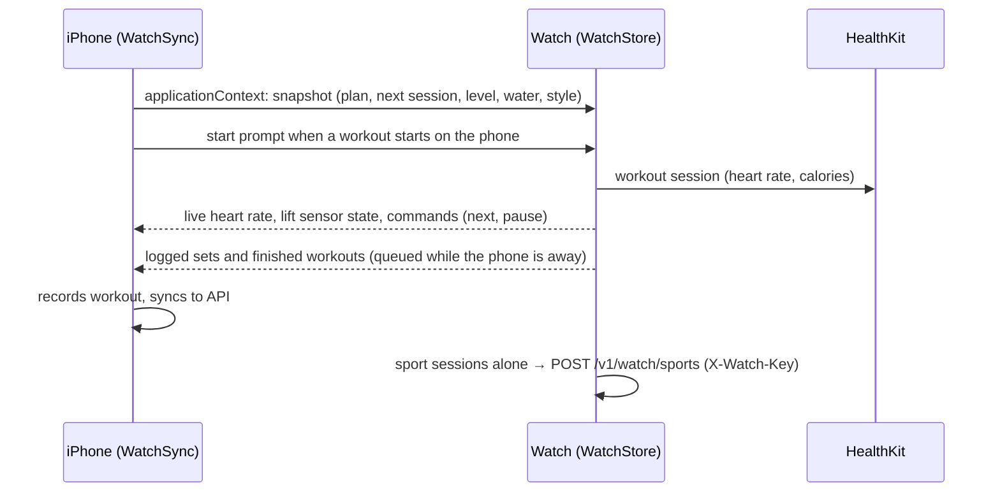
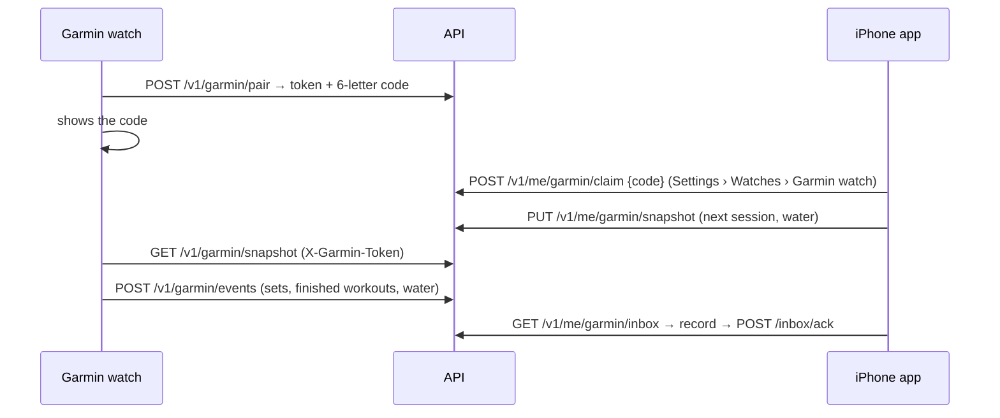

# Watch, widgets and other devices

## Targets and identifiers

| Target | Bundle id | Folder |
|---|---|---|
| iPhone app | `Com.app.MonkeyWorkout` (`.dev` in Debug) | `ios/MonkeyWorkout` |
| Widget extension (Home / Lock Screen widgets, Live Activity) | `….LiveActivity` | `ios/MonkeyWorkoutWidgets`, `ios/HomeWidgets`, `ios/Shared` |
| Watch app | `….watchkitapp` | `ios/MonkeyWorkoutWatch`, `ios/WatchShared` |
| Watch complications | `….watchkitapp.Complications` | `ios/MonkeyWorkoutWatchComplications` |
| Garmin app | Connect IQ | `garmin/` |

**App Group** `group.<app bundle id>` (`APP_GROUP` in `ios/Config/*.xcconfig`) is shared by the app, the widget extension, the Watch app and the complications. It carries the widget snapshot, the water queue and the Watch complication snapshot ([on-device-data.md](on-device-data.md)).

## Apple Watch app

- **Home** (`HomeStyles`, `BrowseViews`): three styles (Coach, Deck, Rings), picked on the phone or the Watch, latest wins. Next session, week, readiness, water.
- **Player** (`PlayerViews`, `WatchPlayer`, `WorkoutManager`): runs a session from the phone's plan or mirrors / remote-controls the iPhone player; rest overlay, effort grid, set logging.
- **Phone start** (`PhoneStartViews`): when the phone starts a workout the Watch is woken and offers to track it.
- **Lift sensor** (`LiftTracker`, `LiftViews`): rep counting from Core Motion, strap prompt, test rep and practice mode, auto-log banner.
- **Sports** (`SportTracker`, `SportViews`) and **Hyrox** (`HyroxTracker`, `HyroxViews`): tracked on the Watch, uploaded directly or via the phone.
- **Compass** (#617): hike, mountaineering and trail run get a compass page where the Watch has a magnetometer: heading (the magnetometer only runs while the page is on screen), **Mark waypoint**, an arrow and distance to the chosen waypoint (tap for the next one) and back to the start.
- **Wrist Coach** (`WristCoach`, #608 C): during a rest the Watch answers the question you'd ask from the sets just logged: failed twice → "Too heavy? Drop to 77.5 kg", 4+ in reserve twice → "Too light? Go to …", failed once → stop one rep short. **Apply** sets the weight of the remaining sets. Rules on the Watch, no iPhone needed.
- **Action button** (Ultra, `ActionButton`): start next up, next, pause, resume as App Intents.
- **Double tap** (watchOS 11): presses the one lime button on screen, marked with a small hand (`LimeButton(pinch:)`, `View.pinch(_:)`, `PinchMark`): log set / start / next on the player, Skip during rest, the iPhone-run player's main button, LAP in sports, DONE in Hyrox. The Crown sets the reps before the pinch.
- **Mirroring** (`WorkoutManager.sendMirror`, iPhone `MirroredWorkout`): every Watch workout session mirrors to the iPhone (`startMirroringToCompanionDevice`). A workout run on the Watch sends its player state (`WMirrorState`) and the iPhone shows it in the **twin player** (`TwinPlayerView`, banner `WatchLiveBanner` on Train); twin presses come back as `WCommand`s (`mirrorCommand`). The iPhone's mirrored session (background mode `workout-processing`) also keeps an iPhone-run workout tracked by the Watch answering it with the phone locked. **Move to Watch** in the player's workout map wakes the Watch to take the workout over.
- Data: `snapshot.json` in the Watch container + App Group snapshot for complications.

### Complications (`MonkeyWorkoutWatchComplications`)

Next workout, Weekly goal, Streak, Week strip, Readiness, Top lift, Last workout, Water, and **My stat** (configurable). All watch families; read from the shared snapshot.

## iPhone widgets (`MonkeyWorkoutWidgets`, `HomeWidgets`)

- **MonkeyWorkout widget** (configurable, App Intent): Next up, This week, Streak, Readiness, Level + XP, Top lifts, Last workout, Volume, Climbing, Fuel, Week dashboard. Families: small, medium, large, Lock Screen circular, rectangular, inline. **Start** opens today's session in the player (`monkeyworkout://start/<id>`), another day says Open.
- **Water widget**: small, medium, Lock Screen circular and rectangular; **+1** counts a glass without opening the app (`AddWaterIntent`); glasses wait in the App Group `WaterQueue` until the app is active.
- Data written by `HomeWidgetSync` to `home-widgets.json` in the App Group; timelines reloaded on changes.
- **Controls** (`Controls.swift`, iOS 18): Start today (`monkeyworkout://today`), Smart next (`monkeyworkout://next`: the player's main step during a workout, else start today), +1 glass (`AddWaterIntent`), Just ate (`monkeyworkout://justate`). For Control Center, the Lock Screen and the iPhone Action button.

## Siri, Shortcuts and Spotlight (`App/SiriIntents.swift`)

- `MonkeyShortcuts` (the app's only `AppShortcutsProvider`): Start today, Log set ("log 8 at 80", `LogSetByVoiceIntent` → `workoutVoiceLog` → player), Add water, Just ate, Best lift (`BestLiftIntent`, answer card), Ask Coach.
- `ExerciseEntity` (`IndexedEntity`): catalog and own exercises; main lifts indexed in Spotlight at launch. The exercise page shares its entity with Siri (`NSUserActivity.appEntityIdentifier`, iOS 18.2) so "my best on this" works there.
- Intents reach the app's `AppModel` through `AppDependencyManager` (`MonkeyWorkoutApp.init`).

## Live Activity (`WorkoutLiveActivity`, `Shared/WorkoutActivity`)

Started by the player: Lock Screen and Dynamic Island show the exercise, set ("Set 2 of 4"), load ("82.5 kg × 8"), rest countdown and what's next, tinted by block. When the coming set is logged by kg × reps, effort tiles log it from the Lock Screen.

On the Apple Watch Smart Stack (`supplementalActivityFamilies([.small])`, `SmallCard`): the set with **Log ✓** (`MainActionIntent`), the rest ring (tap skips) while resting, the summary once done.

## Garmin

Connect IQ app for Forerunner 255/265/955/965, fēnix 7, epix 2, Venu 3, vívoactive 5 (`garmin/`, CI `garmin.yml`).

The watch talks to the server through the Garmin Connect phone app; it records a Garmin strength activity that Garmin Connect writes to Apple Health. `GarminSync` records the events like Apple Watch events (no second Health workout).

## Other watches (Polar, Coros, Suunto, Garmin without the app…)

Gym workouts another app writes to Apple Health (strength, functional, HIIT, core) on a planned session's day appear on Train as **Found in Health · <watch>** with length, heart rate and calories: **Mark done** or **Log sets**. Own workouts and ones already in History within 30 minutes are ignored (`HealthSnapshot.recentGym`, `AppModel.healthMatch`).
