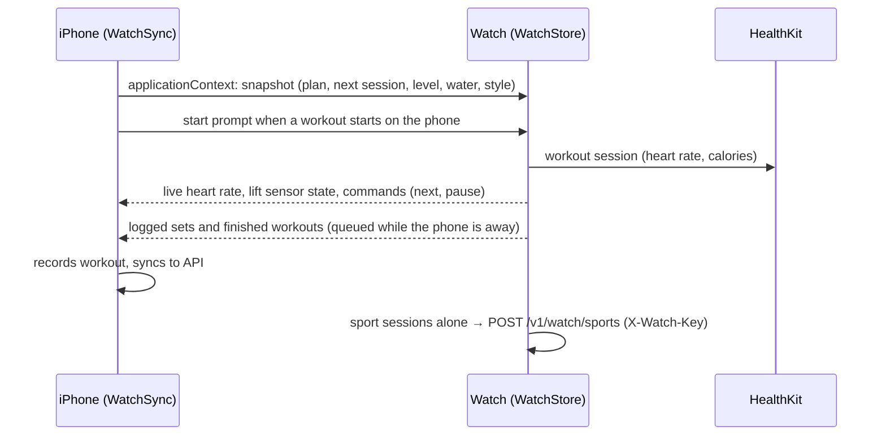
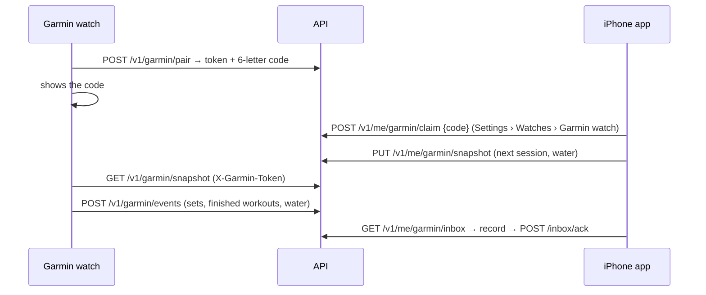

# Watch, widgets and other devices

## Targets and identifiers

| Target | Bundle id | Folder |
|---|---|---|
| iPhone app | `Com.app.MonkeyWorkout` (`.dev` in Debug) | `ios/MonkeyWorkout` |
| Widget extension (Home / Lock Screen widgets, Live Activity) | `….LiveActivity` | `ios/MonkeyWorkoutWidgets`, `ios/HomeWidgets`, `ios/Shared` |
| Watch app | `….watchkitapp` | `ios/MonkeyWorkoutWatch`, `ios/WatchShared` |
| Watch complications | `….watchkitapp.Complications` | `ios/MonkeyWorkoutWatchComplications` |
| Garmin app | Connect IQ | `garmin/` |

**App Group** `group.<app bundle id>` (`APP_GROUP` in `ios/Config/*.xcconfig`) is shared by the app, the widget extension, the Watch app and the complications. It carries the widget snapshot, the water queue and the Watch complication snapshot ([on-device-data.md](on-device-data.md)).

## Apple Watch app

- **Home** (`HomeStyles`, `BrowseViews`): three styles (Coach, Deck, Rings), picked on the phone or the Watch, latest wins. Next session, week, readiness, water.
- **Player** (`PlayerViews`, `WatchPlayer`, `WorkoutManager`): runs a session from the phone's plan or mirrors / remote-controls the iPhone player; rest overlay, effort grid, set logging. **Bike rides** (#623, `BikeSensors`, `BikePower` in the LiftSensor package): Road bike / MTB connect paired Bluetooth power meters (0x1818), cadence sensors (0x1816) and heart-rate straps (0x180D) over CoreBluetooth; **Sensors** (before the start and as a ride page) pairs them and shows battery (0x180F). With a power meter the ride screen is the **power player**: zone tile (Coggan 7 zones from FTP), watts, 3″ average, cadence, strap heart rate. **FTP test · 45′**: 15′ warm-up, 20′ all out, 10′ easy; 95 % of the 20′ average becomes the FTP (event `bikeFTP` to the iPhone; FTP back in the snapshot). **Gym buddy pings** (#626 B, `BuddyPingView`): `WBuddyPing` from the iPhone shows over any screen: a buddy's finished set with 🔥 🍌 🦍 to cheer back (`WatchEvent.buddyCheer`, posted by the iPhone) or a cheer for you, with a haptic. Cool-down blocks are **guided** (`WBlock.guided`, #619): each stretch's timer starts on its own, per-side holds run left then right with a haptic at the switch, the next stretch follows with a start haptic; the block chip reads "Cool-down · 2 of 4". Done screen asks effort (Digital Crown, saved on the Health workout) and mood (saved as a State of Mind).
- **Phone start** (`PhoneStartViews`): when the phone starts a workout the Watch is woken and offers to track it.
- **Lift sensor** (`LiftTracker`, `LiftViews`): rep counting from Core Motion, strap prompt, test rep and practice mode, auto-log banner.
- **Sports** (`SportTracker`, `SportViews`) and **Hyrox** (`HyroxTracker`, `HyroxViews`): tracked on the Watch, uploaded directly or via the phone.
- **Compass** (#617): hike, mountaineering and trail run get a compass page where the Watch has a magnetometer: heading (the magnetometer only runs while the page is on screen), **Mark waypoint**, an arrow and distance to the chosen waypoint (tap for the next one) and back to the start.
- **Wrist Coach** (`WristCoach`, #608 C): during a rest the Watch answers the question you'd ask from the sets just logged: failed twice → "Too heavy? Drop to 77.5 kg", 4+ in reserve twice → "Too light? Go to …", failed once → stop one rep short. **Apply** sets the weight of the remaining sets. Rules on the Watch, no iPhone needed.
- **Swing counter** (#611 B, `ImpactTracker`, `SportViews`): padel, tennis and golf open on forehand / backhand / smash tiles with the top swing speed, from the batched device motion (200 Hz, `CMBatchedSensorManager`, only inside a workout session). Counts saved in the Health workout's metadata (`MonkeyWorkoutSwings`). Lift sets show a **rep speed graph** (#611 A, `RepBars`): bar height = rep speed against the fastest, red past the velocity-loss limit.
- **Timers** (#622, `WodTracker`, `WodViews`): Tabata, EMOM, AMRAP, For time and boxing Rounds (`WodTimer` in `LiftSensor`, shared with the iPhone) plus timers saved on the iPhone (`snapshot.wods`). Runs in a boxing / HIIT workout session: bell, 10″ clap, 3-2-1 ticks as haptics, punches per round from the 800 Hz accelerometer (`PunchCounter`), double tap pauses (`handGestureShortcut`). **Big screen remote** (`TimerRemoteView`): while the iPhone shows a timer full screen, the Watch shows Start / Pause that double tap presses (`wodRemote` / `wodCommand` messages).
- **HIIT** (#693, `HiitViews`: `HiitMirror`, `HiitRemoteView`): while the iPhone plays a HIIT session, the big screen remote carries `WHiitLive` (phase, move, round, clock end, colours) and the Watch shows the step full screen in the phase colour with heart rate; double tap pauses (`wodCommand`). With the Watch app open it runs a HIIT workout session, sends heart rate every 10″ (`heartRate`) and saves the workout to Health when the iPhone logs it (`done`), else discards it; the iPhone then skips its own Health save.
- **Swim** (#615, #624, `SwimTracker`, `SwimViews`): today's swim from the iPhone's plan or gym-day block (`snapshot.swim`), pool 25 / 50 m, open water, snorkel (Ultra, depth). Water Lock at the start. Pool: laps (Health lap events), stroke, pace per 100 m, SWOLF; with a swim workout the send-off clock buzzes every start (`SwimWorkout.clock`). Open water: GPS route, water temperature, buddy alert on the iPhone (`WSwimBuddy` via `transferUserInfo`, local notification `swim-buddy` after the set minutes, cancelled at the end). Depth (`CMWaterSubmersionManager`): depth, max depth, time under water; Apple Watch Ultra, up to 6 m; Watch App ID has Apple's **Shallow Depth and Pressure** capability (#634), entitlement `com.apple.developer.submerged-shallow-depth-and-pressure`, `MWDepth: true` (set false to hide the Snorkel option).
- **Action button** (Ultra, `ActionButton`): start next up, next, pause, resume as App Intents.
- **Double tap** (watchOS 11): presses the one lime button on screen, marked with a small hand (`LimeButton(pinch:)`, `View.pinch(_:)`, `PinchMark`): log set / start / next on the player, Skip during rest, the iPhone-run player's main button, LAP in sports, DONE in Hyrox. The Crown sets the reps before the pinch.
- **Mirroring** (`WorkoutManager.sendMirror`, iPhone `MirroredWorkout`): every Watch workout session mirrors to the iPhone (`startMirroringToCompanionDevice`). A workout run on the Watch sends its player state (`WMirrorState`) and the iPhone shows it in the **twin player** (`TwinPlayerView`, banner `WatchLiveBanner` on Train); twin presses come back as `WCommand`s (`mirrorCommand`). The iPhone's mirrored session (HealthKit wakes the app through `workoutSessionMirroringStartHandler`; no iOS background mode, App Store rejects `workout-processing` on iPhone) also keeps an iPhone-run workout tracked by the Watch answering it with the phone locked. **Move to Watch** in the player's workout map wakes the Watch to take the workout over.
- **Heart-rate zones** (`ZoneTracker`, #609): sport, run and Hyrox screens show five square **zone tiles** (current zone wide and lit) with a buzz on zone change. A **target zone** (picked before a sport, or a planned run's) adds the **target lock**: the screen washes orange (too high) or blue (too low) with "Slow down ↓ 10 bpm". Zones come from the iPhone (`WatchSnapshot.zones`: Apple Health's five zones on iOS 27, else age + resting heart rate). On watchOS 27 the builder gets our zones as a custom configuration when Health has none (`AppleZones.prepare`: `zoneConfiguration(for:)` / `setCustomZoneConfiguration(_:for:)` before `beginCollection`) and Apple's zone changes drive the tiles (`HKLiveWorkoutBuilderDelegate.workoutBuilder(_:didUpdateWorkoutZone:)`); before that the zone comes from each heart-rate reading.
- **Run player** (`SportTracker.run`, `SportTrackView.runDashboard`, #618 B): a planned run (`WRun`, sent with `WSportStart.run` or as `WatchSnapshot.run`, top row of Track a sport) shows each step as a big block: REP 3 OF 6 · 400 M, pace now vs target (✓ within 8 s/km), metres or time left, zone tiles, **NEXT** to skip. Steps move on by distance or time, each one a Health segment, with a buzz and a spoken cue (`AVSpeechSynthesizer`: "Rep 3 of 6. 400 metres at 4 30 a kilometre").
- Data: `snapshot.json` in the Watch container + App Group snapshot for complications.

### Complications (`MonkeyWorkoutWatchComplications`)

Next workout, Weekly goal, Streak, Week strip, Readiness, Top lift, Last workout, Water, and **My stat** (configurable). All watch families; read from the shared snapshot.

**Smart Stack** (`SmartStack.swift`, rectangular): three moment cards that rise on their own. **Gym time**: from 30′ before the usual training time (mean start of recent workouts) to an hour after on a training day, and at the home gym (`snapshot.gym`, 150 m region). **Rest day**: 7:00–10:00, easy day + water pace. **After workout**: the hour after the last workout, recap + protein. Relevance from entry scores (`TimelineEntryRelevance`) and `RelevantIntentManager` (date windows, gym region), refreshed with every timeline.

## iPhone widgets (`MonkeyWorkoutWidgets`, `HomeWidgets`)

- **MonkeyWorkout widget** (configurable, App Intent): Next up, This week, Streak, Readiness, Level + XP, Top lifts, Last workout, Volume, Climbing, Fuel, Week dashboard. Families: small, medium, large, Lock Screen circular, rectangular, inline. **Start** opens today's session in the player (`monkeyworkout://start/<id>`), another day says Open.
- **Water widget**: small, medium, Lock Screen circular and rectangular; **+1** counts a glass without opening the app (`AddWaterIntent`); glasses wait in the App Group `WaterQueue` until the app is active.
- Data written by `HomeWidgetSync` to `home-widgets.json` in the App Group; timelines reloaded on changes.
- **Controls** (`Controls.swift`, iOS 18): Start today (`monkeyworkout://today`), Smart next (`monkeyworkout://next`: the player's main step during a workout, else start today), +1 glass (`AddWaterIntent`), Just ate (`monkeyworkout://justate`). For Control Center, the Lock Screen and the iPhone Action button.

## Siri, Shortcuts and Spotlight (`App/SiriIntents.swift`)

- `MonkeyShortcuts` (the app's only `AppShortcutsProvider`): Start today, Log set ("log 8 at 80", `LogSetByVoiceIntent` → `workoutVoiceLog` → player), Add water, Just ate, Best lift (`BestLiftIntent`, answer card), Ask Coach.
- `ExerciseEntity` (`IndexedEntity`): catalog and own exercises; main lifts indexed in Spotlight at launch. The exercise page shares its entity with Siri (`NSUserActivity.appEntityIdentifier`, iOS 18.2) so "my best on this" works there.
- Intents reach the app's `AppModel` through `AppDependencyManager` (`MonkeyWorkoutApp.init`).

## Live Activity (`WorkoutLiveActivity`, `Shared/WorkoutActivity`)

Started by the player: Lock Screen and Dynamic Island show the exercise, set ("Set 2 of 4"), load ("82.5 kg × 8"), rest countdown and what's next, tinted by block. When the coming set is logged by kg × reps, effort tiles log it from the Lock Screen.

On the Apple Watch Smart Stack (`supplementalActivityFamilies([.small])`, `SmallCard`): the set with **Log ✓** (`MainActionIntent`), the rest ring (tap skips) while resting, the summary once done.

## TV: AirPlay and HDMI (`Views/Plan/TVPlayer.swift`, #724)

- `AppDelegate.application(_:configurationForConnecting:options:)` gives the `.windowExternalDisplayNonInteractive` role `TVSceneDelegate`; every other scene stays SwiftUI's.
- An external screen (Screen Mirroring to an Apple TV or AirPlay TV, or an HDMI adapter) gets its own 16:9 layout instead of the mirrored phone. The phone stays the remote.
- `WorkoutPlayerView.updateLive()` publishes `TVLive` to `TVCast.shared.live` (nil when the player closes). `TVScreen` shows `TVPlayerView` (design mix B + A: full-screen movement, rest/work timer, SET · KG · REPS tiles, heart rate, time, %, one Up next bar) or `TVIdleView`.
- Sizes scale from the screen height (`u = height / 100`). Demo screen `tv-player` draws the layout at 16:9 on the phone.
- Cast button (`CastButton`, `CastSheet`): Chromecast / Google TV and AirPlay get a live video of the same layout.
  - `TVStreamer` hosts `TVScreen` in a 1280×720 window behind the app, draws it 12 times a second (`drawHierarchy`) into an `AVAssetWriter` (`.mpeg4AppleHLS`, 1 s segments, key frame every second).
  - `TVStreamServer`: `NWListener` HTTP on a free port, `live.m3u8` (6 newest segments), `init.mp4`, `seg<n>.m4s`, CORS open; URL uses the Wi-Fi (`en0`) IPv4 address.
  - `CastSession`: Bonjour `_googlecast._tcp` (`CastDevices`), TLS 8009, Cast v2 `CastMessage` protobuf by hand, launches Google's Default Media Receiver `CC1AD845`, `LOAD` live HLS once 3 segments exist. No Google SDK, no receiver page.
  - `AirPlayStream`: `AVPlayer` on the stream + `AVRoutePickerView`; ends when the TV lets go.
  - Stream needs the app in the foreground; 2-5 s behind the phone. Screen Mirroring (scene above) has no delay.

## Garmin

Connect IQ app for Forerunner 255/265/955/965, fēnix 7, epix 2, Venu 3, vívoactive 5 (`garmin/`, CI `garmin.yml`).

The watch talks to the server through the Garmin Connect phone app; it records a Garmin strength activity that Garmin Connect writes to Apple Health. `GarminSync` records the events like Apple Watch events (no second Health workout).

## Other watches (Polar, Coros, Suunto, Garmin without the app…)

Gym workouts another app writes to Apple Health (strength, functional, HIIT, core) on a planned session's day appear on Train as **Found in Health · <watch>** with length, heart rate and calories: **Mark done** or **Log sets**. Own workouts and ones already in History within 30 minutes are ignored (`HealthSnapshot.recentGym`, `AppModel.healthMatch`).
