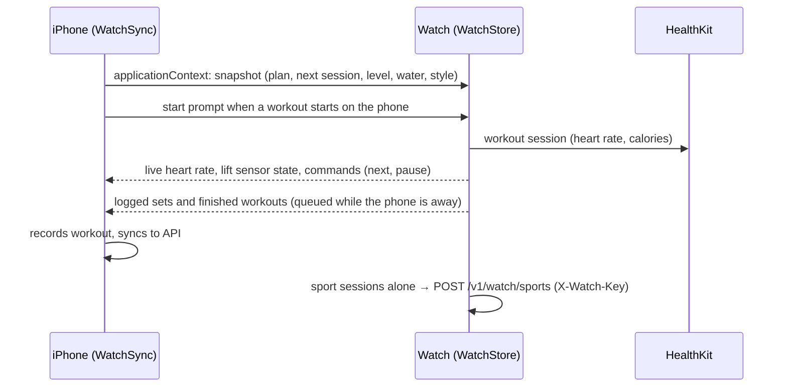
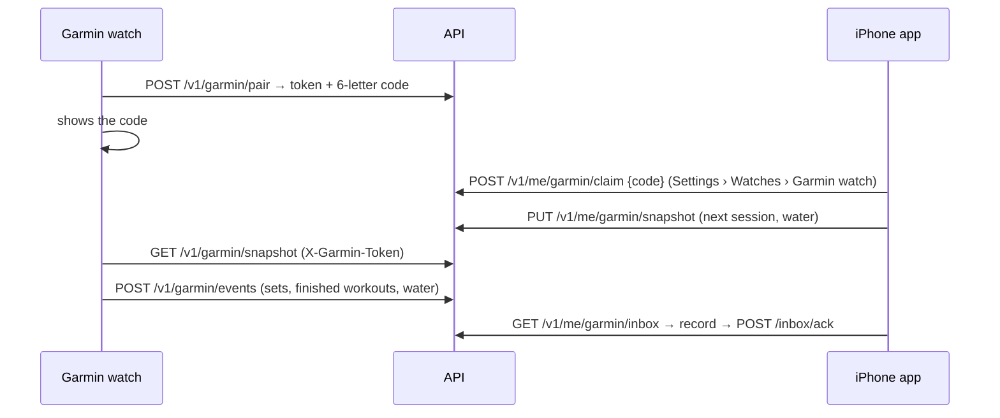

# Watch, widgets and other devices

## Targets and identifiers

| Target | Bundle id | Folder |
|---|---|---|
| iPhone app | `Com.app.MonkeyWorkout` (`.dev` in Debug) | `ios/MonkeyWorkout` |
| Widget extension (Home / Lock Screen widgets, Live Activity) | `….LiveActivity` | `ios/MonkeyWorkoutWidgets`, `ios/HomeWidgets`, `ios/Shared` |
| Watch app | `….watchkitapp` | `ios/MonkeyWorkoutWatch`, `ios/WatchShared` |
| Watch complications | `….watchkitapp.Complications` | `ios/MonkeyWorkoutWatchComplications` |
| Garmin app | Connect IQ | `garmin/` |

**App Group** `group.<app bundle id>` (`APP_GROUP` in `ios/Config/*.xcconfig`) is shared by the app, the widget extension, the Watch app and the complications. It carries the widget snapshot, the water queue and the Watch complication snapshot ([on-device-data.md](on-device-data.md)).

## Apple Watch app

- **Home** (`HomeStyles`, `BrowseViews`): three styles (Coach, Deck, Rings), picked on the phone or the Watch, latest wins. Next session, week, readiness, water.
- **Player** (`PlayerViews`, `WatchPlayer`, `WorkoutManager`): runs a session from the phone's plan or mirrors / remote-controls the iPhone player; rest overlay, effort grid, set logging.
- **Phone start** (`PhoneStartViews`): when the phone starts a workout the Watch is woken and offers to track it.
- **Lift sensor** (`LiftTracker`, `LiftViews`): rep counting from Core Motion, strap prompt, test rep and practice mode, auto-log banner.
- **Sports** (`SportTracker`, `SportViews`) and **Hyrox** (`HyroxTracker`, `HyroxViews`): tracked on the Watch, uploaded directly or via the phone.
- **Action button** (Ultra, `ActionButton`): start next up, next, pause, resume as App Intents.
- Data: `snapshot.json` in the Watch container + App Group snapshot for complications.

### Complications (`MonkeyWorkoutWatchComplications`)

Next workout, Weekly goal, Streak, Week strip, Readiness, Top lift, Last workout, Water, and **My stat** (configurable). All watch families; read from the shared snapshot.

## iPhone widgets (`MonkeyWorkoutWidgets`, `HomeWidgets`)

- **MonkeyWorkout widget** (configurable, App Intent): Next up, This week, Streak, Readiness, Level + XP, Top lifts, Last workout, Volume, Climbing, Fuel, Week dashboard. Families: small, medium, large, Lock Screen circular, rectangular, inline. **Start** opens today's session in the player (`monkeyworkout://start/<id>`), another day says Open.
- **Water widget**: small, medium, Lock Screen circular and rectangular; **+1** counts a glass without opening the app (`AddWaterIntent`); glasses wait in the App Group `WaterQueue` until the app is active.
- Data written by `HomeWidgetSync` to `home-widgets.json` in the App Group; timelines reloaded on changes.

## Live Activity (`WorkoutLiveActivity`, `Shared/WorkoutActivity`)

Started by the player: Lock Screen and Dynamic Island show the exercise, set ("Set 2 of 4"), load ("82.5 kg × 8"), rest countdown and what's next, tinted by block. When the coming set is logged by kg × reps, effort tiles log it from the Lock Screen.

## Garmin

Connect IQ app for Forerunner 255/265/955/965, fēnix 7, epix 2, Venu 3, vívoactive 5 (`garmin/`, CI `garmin.yml`).

The watch talks to the server through the Garmin Connect phone app; it records a Garmin strength activity that Garmin Connect writes to Apple Health. `GarminSync` records the events like Apple Watch events (no second Health workout).

## Other watches (Polar, Coros, Suunto, Garmin without the app…)

Gym workouts another app writes to Apple Health (strength, functional, HIIT, core) on a planned session's day appear on Train as **Found in Health · <watch>** with length, heart rate and calories: **Mark done** or **Log sets**. Own workouts and ones already in History within 30 minutes are ignored (`HealthSnapshot.recentGym`, `AppModel.healthMatch`).
